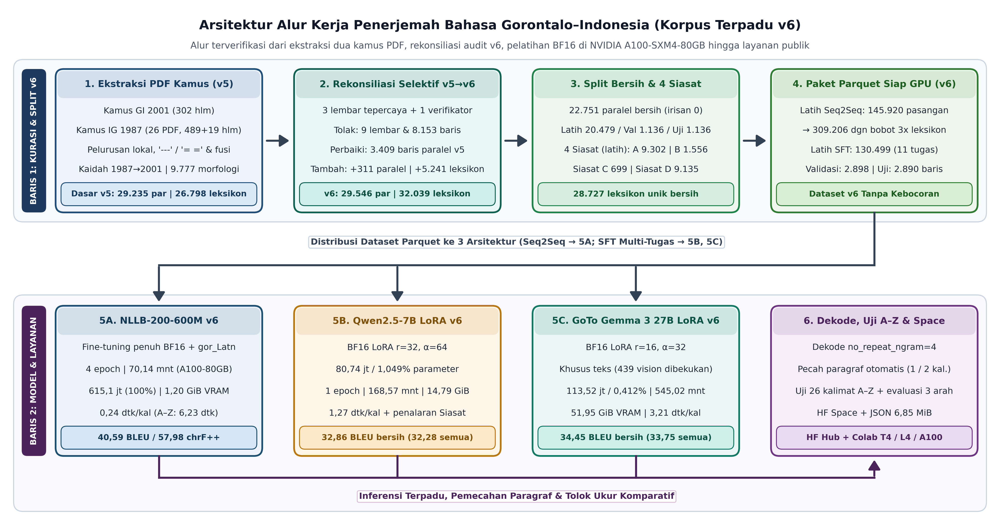
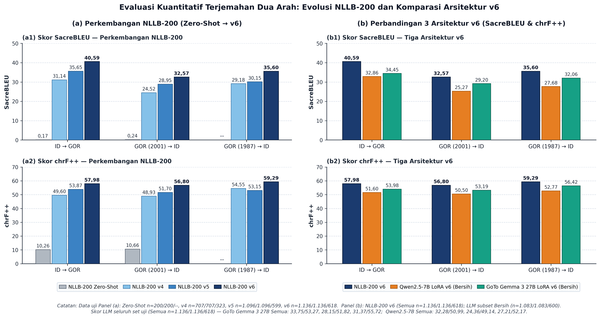

<div align="center">

# Penerjemah AI & Kamus Dwibahasa Bahasa Indonesia $\leftrightarrow$ Bahasa Gorontalo (v6)

**Rekonsiliasi Korpus Selektif, Empat Siasat Linguistik Prof. Mansoer Pateda, dan Tolok Ukur Tiga Arsitektur (`NLLB-200`, `Qwen2.5-7B LoRA`, `GoTo Gemma 3 27B LoRA`)**

[](https://huggingface.co/spaces/panitagorontalo/penerjemah-bahasa-gorontalo)
[](https://colab.research.google.com/github/panitaresearch/penerjemah-bahasa-gorontalo/blob/main/Tutorial_Penerjemah_AI_Bahasa_Gorontalo_Panita_Research.ipynb)
[](./paper/paper_id.pdf)
[](./paper/paper_en.pdf)
[](./LICENSE)

**Dikembangkan oleh [Panita Research Gorontalo](https://panita.web.id)** · Organisasi Hub: [`panitagorontalo`](https://huggingface.co/panitagorontalo)

</div>

---

## Ringkasan Ekosistem & Tautan Utama

Repositori ini berisi **kode sumber lengkap, skrip ekstraksi kamus, pipeline rekonsiliasi v6, pelatihan tiga arsitektur model di GPU, CLI inferensi, antarmuka web Gradio/statis, hasil evaluasi terverifikasi (`JSON`), serta naskah makalah ilmiah** untuk penerjemahan dua arah **Bahasa Indonesia (`ind_Latn`) $\leftrightarrow$ Bahasa Gorontalo / *Bahasa Hulontalo* (`gor_Latn`)**.

> **Catatan tentang dataset & bobot model:** Sesuai kebijakan repositori, **dataset mentah/parquet dan scan PDF kamus tidak disimpan di GitHub**, sedangkan **bobot ketiga model (`3,1 GiB`) dan demo kamus terpasang publik di Hugging Face Hub & Space**.

| Artefak | Lokasi Publik | Kegunaan Utama |
|---|---|---|
| **Demo Web & Kamus Instan** | [`panitagorontalo/penerjemah-bahasa-gorontalo`](https://huggingface.co/spaces/panitagorontalo/penerjemah-bahasa-gorontalo) | Pencarian **32.039** leksikon, **9.777** derivasi morfologi, **29.546** kalimat paralel, konverter ejaan `1987 ↔ 2001`, dan uji terjemahan paragraf |
| **Model 1 — `NLLB-200-600M v6`** | [`panitagorontalo/nllb-200-gorontalo-bi-600M`](https://huggingface.co/panitagorontalo/nllb-200-gorontalo-bi-600M) | Penerjemah neural tercepat & tertinggi metrik kalimat (**`40,59` SacreBLEU / `57,98` chrF++** `ID→GOR`), bisa berjalan di CPU |
| **Model 2 — `Qwen2.5-7B LoRA v6`** | [`panitagorontalo/qwen2.5-7b-gorontalo-lora`](https://huggingface.co/panitagorontalo/qwen2.5-7b-gorontalo-lora) | LLM instruksi 7B ringan (muat di Colab T4 15 GB lewat 4-bit QLoRA) + penalaran morfologi Siasat A & B |
| **Model 3 — `GoTo Gemma 3 27B LoRA v6`** | [`panitagorontalo/gemma3-27b-gotoai-gorontalo-lora`](https://huggingface.co/panitagorontalo/gemma3-27b-gotoai-gorontalo-lora) | LLM Nusantara 27B (`GoToCompany/gemma3-27b-cpt-gotoai-v3-instruct`), terbaik di kelas LLM (**`34,45` BLEU** `ID→GOR`, **`29,20` BLEU** `GOR→ID` Clean) & paling tangguh menjaga keutuhan paragraf pendek |
| **Notebook Google Colab** | [`Tutorial_Penerjemah_AI_Bahasa_Gorontalo_Panita_Research.ipynb`](./Tutorial_Penerjemah_AI_Bahasa_Gorontalo_Panita_Research.ipynb) | Menjalankan seluruh 3 model + antarmuka web Gradio (`share=True`) di Colab gratis/berbayar |
| **Makalah Ilmiah (v6)** | [Bahasa Indonesia (`paper_id.pdf`)](./paper/paper_id.pdf) · [English (`paper_en.pdf`)](./paper/paper_en.pdf) | Dokumentasi lengkap metodologi v6, benchmark lintas versi, uji 26 kalimat A–Z, dan studi *chunking* paragraf |

---

## Arsitektur Pipeline & Hasil Benchmark v6

<p align="center">
  
</p>

### 1. Ringkasan Data & Rekonsiliasi Korpus v6
* **Dua Rujukan Kamus Prof. Dr. H. Mansoer Pateda:**
  1. *Kamus Bahasa Gorontalo–Indonesia* (Balai Pustaka, 2001 — `302` halaman leksikon; `4.246` lema pokok, `3.822` sub-lema).
  2. *Kamus Bahasa Indonesia–Gorontalo* (Pusat Bahasa, 1987 — `489` halaman leksikon + `19` halaman pengantar pada `26` PDF abjad A–Z; `9.308` lema pokok, `6.454` sub-lema).
* **Rekonsiliasi Selektif v5 $\rightarrow$ v6 (`reconcile_v6_audit.py`):** Menolak `9` lembar bermasalah dan `8.153` baris rusak, memperbaiki **`3.409` baris paralel v5** (termasuk `2.196` pemulihan pemotongan kolom cetak dan `600` perbaikan OCR Indonesia), serta menambah `+311` kalimat paralel dan `+5.241` entri kosakata baru $\rightarrow$ total mentah **`29.546` kalimat paralel**, **`32.039` leksikon**, dan **`9.777` pasangan morfologi**.
* **Pemisahan Tanpa Kebocoran (*Zero-Leakage Split*) + 4 Siasat Pateda:** Menghasilkan **`22.751` kalimat paralel unik bersih** (`20.479` latih / `1.136` validasi / `1.136` uji; irisan `0`) dan **`28.727` leksikon unik bersih**. Augmentasi **Empat Siasat Pateda** (*A: `9.302`, B: `1.556`, C: `699`, D: `9.135`*) diterapkan **khusus pada data latih**, membentuk **`145.920` pasangan Seq2Seq** (`309.206` dengan pembobotan `3×` frasa pendek) dan **`130.499` instruksi SFT multi-tugas** (11 jenis tugas; validasi `2.898`, uji `2.890`).

### 2. Skor Kuantitatif Resmi (NVIDIA A100-SXM4-80GB, `bfloat16`)

| Model & Versi | Data Uji ($n$) | `ID → GOR (2001)` (`SacreBLEU / chrF++`) | `GOR (2001) → ID` (`SacreBLEU / chrF++`) | `GOR (1987) → ID` (`SacreBLEU / chrF++`) | Latensi 26 Kalimat A–Z | Puncak VRAM Inferensi |
|---|---|---|---|---|---|---|
| NLLB-200 Zero-Shot (`v6 test`) | `200 / 200 / —` | `0.17 / 10.26` | `0.24 / 10.66` | — | — | — |
| NLLB-200 v4 | `707 / 707 / 323` | `31.14 / 49.60` | `24.52 / 48.93` | `29.18 / 54.55` | — | — |
| NLLB-200 v5 | `1.096 / 1.096 / 599` | `35.65 / 53.87` | `28.95 / 51.70` | `30.15 / 53.15` | — | — |
| **`NLLB-200 v6` (Terbaik Kalimat)** | **`1.136 / 1.136 / 618`** | **`40.59 / 57.98`** | **`32.57 / 56.80`** | **`35.60 / 59.29`** | **`6,23 detik` (`0,24 dtk/kal`)** | **`1,20 GiB`** |
| `Qwen2.5-7B LoRA v6` (Semua) | `1.136 / 1.136 / 618` | `32.28 / 50.99` | `24.36 / 49.14` | `27.21 / 52.17` | `32,90 detik` (`1,27 dtk/kal`) | `14,79 GiB` (`bf16`) |
| `Qwen2.5-7B LoRA v6` (Bersih) | `1.083 / 1.083 / 600` | `32.86 / 51.60` | `25.27 / 50.50` | `27.68 / 52.77` | `32,90 detik` (`1,27 dtk/kal`) | `~5,5 GB` (`4-bit QLoRA`) |
| `GoTo Gemma 3 27B LoRA v6` (Semua) | `1.136 / 1.136 / 618` | `33.75 / 53.27` | `28.15 / 51.82` | `31.37 / 55.72` | `83,49 detik` (`3,21 dtk/kal`) | `51,95 GiB` (`bf16`) |
| **`GoTo Gemma 3 27B LoRA v6` (Bersih, LLM Terbaik)** | **`1.083 / 1.083 / 600`** | **`34.45 / 53.98`** | **`29.20 / 53.19`** | **`32.06 / 56.42`** | **`83,49 detik` (`3,21 dtk/kal`)** | **`≥ 24 GB` (`4-bit QLoRA`)** |

<p align="center">
  
</p>

---

## Panduan Lengkap Menjalankan Model

### Opsi A — Langsung Tanpa Instalasi (Browser & Google Colab)
1. **Demo Web & Kamus Instan:** Buka [Hugging Face Space Panita](https://huggingface.co/spaces/panitagorontalo/penerjemah-bahasa-gorontalo) untuk kamus dwibahasa, morfologi, konverter ejaan, serta terjemahan instan di browser.
2. **Google Colab 1-Klik:** Klik lencana **Open In Colab** di atas untuk menjalankan ketiga model (`NLLB-200`, `Qwen2.5-7B LoRA`, `GoTo Gemma 3 27B LoRA`) lengkap dengan peladen Gradio.

---

### Opsi B — Panduan Kebutuhan Perangkat Keras (*Hardware Guide*)

| Model Target | RAM / VRAM Minimum yang Disarankan | Cocok Untuk |
|---|---|---|
| **`panitagorontalo/nllb-200-gorontalo-bi-600M`** | **CPU 8–16 GB RAM** (atau GPU apa saja, `1,20 GiB` VRAM CUDA) | Laptop standar, server CPU, HF Space CPU Basic (`~1–3 detik/kalimat` di CPU; `0,24 dtk/kal` di A100) |
| **`panitagorontalo/qwen2.5-7b-gorontalo-lora`** | **GPU 16 GB `bf16`** (`14,79 GiB` VRAM) atau **GPU 8–15 GB via `--load-in-4bit`** (`~5,5 GB` VRAM) | Google Colab **T4 15 GB** gratis (`4-bit`), RTX 3060/4060 Ti 16 GB, L4/A10G |
| **`panitagorontalo/gemma3-27b-gotoai-gorontalo-lora`** | **GPU ≥ 24 GB via `--load-in-4bit`** (`~18 GB` VRAM) atau **A100-80GB `bf16`** (`51,95 GiB` VRAM + cache `51,10 GiB`) | Google Colab **L4 24 GB** / **A100 80 GB**, RTX 3090 / 4090 / A6000 |

---

### Opsi C — Instalasi Lokal & Menjalankan lewat CLI (`infer_gorontalo.py`)

Skrip [infer_gorontalo.py](./infer_gorontalo.py) otomatis memakai direktori `./models/...` apabila bobot sudah tersedia di lokal, dan **otomatis mengunduh model langsung dari Hugging Face Hub (`panitagorontalo/*`)** apabila dijalankan di hasil `git clone` baru.

```bash
# 1. Klon repositori
git clone https://github.com/panitaresearch/penerjemah-bahasa-gorontalo.git
cd penerjemah-bahasa-gorontalo

# 2. Buat virtual environment (disarankan) & pasang dependensi utama
python3 -m venv .venv
source .venv/bin/activate
pip install -U pip
pip install -r requirements.txt

# 3. (Opsional) Pasang bitsandbytes jika ingin menjalankan Qwen/Gemma3 dalam mode --load-in-4bit
pip install bitsandbytes>=0.44.0
```

#### Contoh Perintah CLI

```bash
# 1) Terjemahan kalimat tunggal dengan NLLB-200 (otomatis jalan di CPU atau GPU)
python3 infer_gorontalo.py --model nllb --direction id2gor --text "Saya pergi ke pasar kemarin."

# 2) Terjemahan balik Gorontalo -> Indonesia (mendukung input ejaan 2001 maupun 1987)
python3 infer_gorontalo.py --model nllb --direction gor2id --text "Ti Pa:pa lopopandango buatulo alihu batade di:la mowali moliba:ya."

# 3) Terjemahan paragraf panjang otomatis (pemecahan kalimat + restorasi titik/tanya/seru)
python3 infer_gorontalo.py --model nllb --direction id2gor --text "Kemarin pagi ayah pergi ke pasar untuk membeli ikan dan beras. Di jalan beliau bertemu dengan paman yang baru pulang dari kebun. Setelah berbelanja, ayah langsung pulang ke rumah karena ibu sudah menunggu di dapur. Sore harinya kami makan bersama dengan keluarga di halaman rumah."

# 4) Menjalankan Qwen2.5-7B LoRA dalam 4-bit (cocok untuk Colab T4 15 GB / RTX 8-12 GB)
python3 infer_gorontalo.py --model qwen --load-in-4bit --direction id2gor --text "Tiap pagi halaman rumah harus disapu."

# 5) Bertanya penalaran morfologi / kata serapan ke LLM (tambahkan --instruction, tanpa auto-split kalimat)
python3 infer_gorontalo.py --model qwen --load-in-4bit --direction id2gor \
  --instruction "Adaptasikan kata bahasa Indonesia berikut ke dalam bahasa Gorontalo sesuai kaidah fonotaktik vokalis Prof. Mansoer Pateda beserta contoh imbuhannya." \
  --text "adil"

# 6) Menjalankan GoTo Gemma 3 27B LoRA (4-bit untuk GPU >= 24 GB; hilangkan --load-in-4bit di A100-80GB)
python3 infer_gorontalo.py --model gemma3 --load-in-4bit --direction gor2id \
  --text "Ola:ngo dumodupo ti Pa:pa lo:nao ode pa:tali motali uponula wawu pale. To dalalo tiyo lopodunggaya woli Omu ta boheli lo:wuli monto ileengi."

# 7) Mode interaktif di terminal (model dimuat satu kali lalu bisa menerjemahkan berkali-kali)
python3 infer_gorontalo.py --model nllb --direction id2gor --interactive
```

**Catatan Penting Strategi *Chunking* Paragraf (`--chunk-sentences` & `--no-split`):**
* Karena model dilatih per kalimat (`MAX_LENGTH=128` untuk NLLB, `MAX_SEQ_LEN=256` untuk Qwen/Gemma 3), mengirim paragraf panjang sekaligus tanpa dipecah dapat memotong kalimat akhir pada `NLLB` dan `Qwen`.
* Secara bawaan, `infer_gorontalo.py` otomatis memakai `sentences_per_chunk=1` pada `NLLB`/`Qwen` dan `Gemma 3 (id2gor)`, serta `sentences_per_chunk=2` khusus pada `Gemma 3 (gor2id)` (terbukti paling runtut & bebas artefak perulangan kata berhubung pada uji 4 kalimat). Gunakan `--chunk-sentences N` atau `--no-split` untuk menimpa pengaturan ini.

---

### Opsi D — Contoh Kode Python Langsung via Hugging Face `transformers`

#### 1. Model 1: `NLLB-200-distilled-600M v6` (Paling Ringan & Akurat di Kalimat)

```python
import re
import torch
from transformers import AutoModelForSeq2SeqLM, AutoTokenizer

MODEL_ID = "panitagorontalo/nllb-200-gorontalo-bi-600M"
device = "cuda" if torch.cuda.is_available() else "cpu"
dtype = torch.bfloat16 if (device == "cuda" and torch.cuda.is_bf16_supported()) else (torch.float16 if device == "cuda" else torch.float32)

tokenizer = AutoTokenizer.from_pretrained(MODEL_ID)
model = AutoModelForSeq2SeqLM.from_pretrained(MODEL_ID, dtype=dtype).to(device).eval()

def translate_nllb(text: str, direction: str = "id2gor") -> str:
    src_lang = "ind_Latn" if direction == "id2gor" else "gor_Latn"
    tgt_lang = "gor_Latn" if direction == "id2gor" else "ind_Latn"
    src_id = tokenizer.convert_tokens_to_ids(src_lang)
    tgt_id = tokenizer.convert_tokens_to_ids(tgt_lang)
    eos_id = tokenizer.eos_token_id

    paras = [p.strip() for p in re.split(r"\n+", text.strip()) if p.strip()]
    out_paras = []
    for para in paras:
        sents = [s.strip() for s in re.split(r"(?<=[.!?])\s+", para) if s.strip()]
        translated = []
        for sent in sents:
            sub_ids = tokenizer(sent, add_special_tokens=False, truncation=True, max_length=250)["input_ids"]
            inp = torch.tensor([[src_id] + sub_ids + [eos_id]], dtype=torch.long, device=device)
            with torch.inference_mode():
                gen = model.generate(
                    input_ids=inp,
                    forced_bos_token_id=tgt_id,
                    max_new_tokens=192,
                    num_beams=4,
                    no_repeat_ngram_size=4,
                    early_stopping=True,
                )
            pred = tokenizer.decode(gen[0], skip_special_tokens=True).strip()
            if len(sents) > 1 and pred and not pred.endswith((".", "!", "?")):
                pred += sent[-1] if sent.endswith(("?", "!")) else "."
            translated.append(pred)
        out_paras.append(" ".join(translated))
    return "\n\n".join(out_paras)

print(translate_nllb("Adik mengambil air minum di dapur.", "id2gor"))
print(translate_nllb("Wa:tiya lo:nao ode pa:tali ola:ngo.", "gor2id"))
```

#### 2. Model 2: `Qwen2.5-7B-Instruct LoRA v6` (Bisa 4-bit di Colab T4 15 GB)

```python
import torch
from peft import PeftModel
from transformers import AutoModelForCausalLM, AutoTokenizer, BitsAndBytesConfig

BASE_MODEL = "Qwen/Qwen2.5-7B-Instruct"
LORA_ADAPTER = "panitagorontalo/qwen2.5-7b-gorontalo-lora"

SYSTEM_PROMPT = (
    "Anda adalah pakar bahasa dan penerjemah dwibahasa Bahasa Indonesia <-> Bahasa Gorontalo "
    "yang menguasai tata bahasa, 5 sistem kala, morfofonemik, morfem penunjuk arah (mayi, mao, mola, mota), "
    "dan kaidah leksikografi Prof. Dr. H. Mansoer Pateda."
)

compute_dtype = torch.bfloat16 if torch.cuda.is_bf16_supported() else torch.float16
bnb_cfg = BitsAndBytesConfig(
    load_in_4bit=True,
    bnb_4bit_quant_type="nf4",
    bnb_4bit_use_double_quant=True,
    bnb_4bit_compute_dtype=compute_dtype,
)

tokenizer = AutoTokenizer.from_pretrained(LORA_ADAPTER)
base_model = AutoModelForCausalLM.from_pretrained(BASE_MODEL, quantization_config=bnb_cfg, device_map="auto")
model = PeftModel.from_pretrained(base_model, LORA_ADAPTER).eval()

instruction = "Terjemahkan kalimat bahasa Indonesia berikut ke dalam bahasa Gorontalo yang baik dan benar sesuai kaidah Prof. Mansoer Pateda."
prompt = (
    f"<|im_start|>system\n{SYSTEM_PROMPT}<|im_end|>\n"
    f"<|im_start|>user\n{instruction}\n\nInput: Ibu pergi membeli beras di pasar.<|im_end|>\n"
    f"<|im_start|>assistant\n"
)
enc = tokenizer(prompt, return_tensors="pt").to(model.device)
with torch.inference_mode():
    out = model.generate(**enc, max_new_tokens=192, do_sample=False, no_repeat_ngram_size=4)
print(tokenizer.decode(out[0, enc["input_ids"].shape[1]:], skip_special_tokens=True).strip())
```

#### 3. Model 3: `GoTo Gemma 3 27B LoRA v6` (Terbaik di Kelas LLM; GPU ≥ 24 GB 4-bit atau A100-80GB `bf16`)

```python
import torch
from peft import PeftModel
from transformers import AutoModelForCausalLM, AutoTokenizer, BitsAndBytesConfig

BASE_MODEL = "GoToCompany/gemma3-27b-cpt-gotoai-v3-instruct"
LORA_ADAPTER = "panitagorontalo/gemma3-27b-gotoai-gorontalo-lora"

SYSTEM_PROMPT = (
    "Anda adalah pakar bahasa dan penerjemah dwibahasa Bahasa Indonesia <-> Bahasa Gorontalo "
    "yang menguasai tata bahasa, 5 sistem kala, morfofonemik, morfem penunjuk arah (mayi, mao, mola, mota), "
    "dan kaidah leksikografi Prof. Dr. H. Mansoer Pateda."
)

# Gunakan BitsAndBytesConfig 4-bit untuk L4/RTX 24 GB, atau dtype=torch.bfloat16 tanpa quantization_config di A100-80GB
bnb_cfg = BitsAndBytesConfig(
    load_in_4bit=True,
    bnb_4bit_quant_type="nf4",
    bnb_4bit_use_double_quant=True,
    bnb_4bit_compute_dtype=torch.bfloat16,
)
tokenizer = AutoTokenizer.from_pretrained(LORA_ADAPTER)
if tokenizer.pad_token is None:
    tokenizer.pad_token = tokenizer.eos_token

base_model = AutoModelForCausalLM.from_pretrained(BASE_MODEL, quantization_config=bnb_cfg, device_map="auto")
model = PeftModel.from_pretrained(base_model, LORA_ADAPTER).eval()

eos_ids = [
    i for i in [tokenizer.eos_token_id, tokenizer.convert_tokens_to_ids("<end_of_turn>")]
    if isinstance(i, int) and i >= 0
]
messages = [
    {"role": "system", "content": SYSTEM_PROMPT},
    {"role": "user", "content": "Terjemahkan kalimat bahasa Indonesia berikut ke dalam bahasa Gorontalo yang baik dan benar sesuai kaidah Prof. Mansoer Pateda.\n\nInput: Ayah menggali lubang di belakang rumah."},
]
prompt = tokenizer.apply_chat_template(messages, tokenize=False, add_generation_prompt=True)
enc = tokenizer(prompt, add_special_tokens=False, return_tensors="pt").to(model.device)
with torch.inference_mode():
    out = model.generate(
        **enc,
        max_new_tokens=192,
        do_sample=False,
        top_k=None,
        top_p=None,
        no_repeat_ngram_size=4,
        pad_token_id=tokenizer.pad_token_id,
        eos_token_id=eos_ids or tokenizer.eos_token_id,
    )
print(tokenizer.decode(out[0, enc["input_ids"].shape[1]:], skip_special_tokens=True).strip())
```

---

### Opsi E — Menjalankan Antarmuka Web Gradio Lokal ([`hf_space_gorontalo/app.py`](./hf_space_gorontalo/app.py))

```bash
cd hf_space_gorontalo
pip install -r requirements.txt
python3 app.py
```

Server Gradio memuat model neural (`MODEL_ID` bawaan `panitagorontalo/nllb-200-gorontalo-bi-600M`, bisa diubah via variabel lingkungan `MODEL_ID`) lengkap dengan fitur pemecahan paragraf otomatis dan tab pencarian kamus/morfologi (apabila Anda menempatkan `corpus_gorontalo.json` & `data/*.parquet` dari [HF Space](https://huggingface.co/spaces/panitagorontalo/penerjemah-bahasa-gorontalo/tree/main) ke `hf_space_gorontalo/`).

---

## Alur Reproduksi Pipeline Ekstraksi & Training

Apabila Anda menyiapkan berkas PDF kamus asli di lokasi yang diharapkan oleh skrip serta lembar kurasi, seluruh alur kerja dapat direproduksi berurutan:

1. **Ekstraksi Kamus GI 2001 & IG 1987:**
   * [`gorontaloindonesia/extract_gi_v5.py`](./gorontaloindonesia/extract_gi_v5.py)
   * [`indonesiagorontalo/extract_ig_v5.py`](./indonesiagorontalo/extract_ig_v5.py)
   * [`indonesiagorontalo/build_master_and_combined_datasets.py`](./indonesiagorontalo/build_master_and_combined_datasets.py)
2. **Audit & Rekonsiliasi Korpus v5 $\rightarrow$ v6:**
   * `python3 reconcile_v6_audit.py` (mode *dry-run* dulu) lalu `--apply` ([`reconcile_v6_audit.py`](./reconcile_v6_audit.py))
3. **Pemisahan *Zero-Leakage* & Augmentasi 4 Siasat Pateda:**
   * `python3 build_augmented_sft_dataset.py` ([`build_augmented_sft_dataset.py`](./build_augmented_sft_dataset.py))
4. **Pelatihan & Evaluasi Ketiga Model (NVIDIA A100-80GB, Dilindungi [`training_resilience.py`](./training_resilience.py)):**
   * `python3 -u train_nllb_gorontalo.py` (`4` epoch, `MAX_LENGTH=128`, `bf16`)
   * `QWEN_GRAD_CKPT=0 QWEN_BATCH_SIZE=64 QWEN_GRAD_ACCUM=1 python3 -u train_qwen_lora_gorontalo.py` (`r=32, alpha=64`)
   * `python3 -u train_gemma3_27b_lora_gorontalo.py` (`bf16` LoRA `r=16, alpha=32` hanya pada layer teks dengan `439` tensor visi dibekukan; tersedia fallback `GEMMA_LOAD_IN_4BIT=1`)
5. **Sinkronisasi & Publikasi ke Hugging Face (`panitagorontalo`):**
   * `python3 push_all_to_hf.py --sync-only` (lokal saja) atau `HF_TOKEN=... python3 push_all_to_hf.py`

---

## Ringkasan Kaidah Linguistik Prof. Mansoer Pateda

1. **Jembatan Dua Ortografi (`1987 ↔ 2001`):** Ejaan 1987 memakai vokal ganda (`aa, ee, ii, oo, uu`), glotal `?` (`wa?u, lo?otapu`), tanpa luncuran eksplisit (`tio, boito, mai, wau`), sedangkan target baku korpus memakai ejaan 2001 bertitik dua `:` (`pa:tali, wa:tiya, di:la`), tanpa `?` (`wau, lootapu`), dengan luncuran eksplisit `y/w` (`tiyo, boyito, mayi, wawu`).
2. **Lima Sistem Kala:** Kala Akan (`/m/`), Sedang Masih (`hemo-/hemoti-`), Sedang (reduplikasi), Sedang Lampau (`helo-/heloti-`), dan Kala Lampau (`/l/`, `-il-`).
3. **Empat Siasat Mengatasi Keterbatasan Kosakata:**
   * **Siasat A (Morphological Engine):** 31 sistem prefiks, infiks, sufiks, peluluhan konsonan awal (`/t/→/l/`, `/s/→/n/`, `/p/→/m/`, `/k/→/ng/`), dan pergeseran `-o → -a`.
   * **Siasat B (Loanword Phonologization BI → BG):** Penambahan vokal akhir agar selaras dengan sifat vokalis Gorontalo + imbuhan produktif (`adil → a:dili → moa:dili / a:diliyolo`).
   * **Siasat C (Analytical Paraphrasing & MPA):** Kata dasar + empat morfem penunjuk arah (*mayi, mao, mola, mota*).
   * **Siasat D (Lexical Synonym Bridging & Register):** Variasi sinonim KBBI serta pembedaan ragam Biasa (`wau / yio`) vs Hormat (`wa:tiya / ito`).

---

## Struktur Repositori

```text
penerjemah-bahasa-gorontalo/
├── README.md                                  # Dokumentasi lengkap, metrik, & panduan inferensi
├── LICENSE                                    # Lisensi Apache-2.0
├── CITATION.cff                               # Metadata sitasi repositori
├── requirements.txt                           # Dependensi Python
├── infer_gorontalo.py                         # CLI inferensi + pemecahan paragraf & opsi 4-bit
├── reconcile_v6_audit.py                      # Skrip audit & rekonsiliasi korpus v5 -> v6
├── build_augmented_sft_dataset.py             # Split tanpa kebocoran + Empat Siasat Pateda
├── train_nllb_gorontalo.py                    # Fine-tuning NLLB-200-distilled-600M (bf16)
├── train_qwen_lora_gorontalo.py               # Fine-tuning Qwen2.5-7B-Instruct LoRA
├── train_gemma3_27b_lora_gorontalo.py         # Fine-tuning GoTo Gemma 3 27B Text-Only LoRA
├── training_resilience.py                     # Utilitas checkpoint validation & graceful stop
├── push_all_to_hf.py                          # Skrip sinkronisasi & publikasi HF Hub/Space
├── Tutorial_Penerjemah_AI_Bahasa_Gorontalo_Panita_Research.ipynb
├── hf_space_gorontalo/                        # Kode aplikasi Space (app.py, index.html, README.md)
├── gorontaloindonesia/                        # Ekstraktor GI 2001 & dokumen_pengantar/ kaidah bahasa
├── indonesiagorontalo/                        # Ekstraktor IG 1987, penyatuan, & dokumen_pengantar/
├── dataset_terpadu_indonesia_gorontalo/       # Statistik v6, evaluasi_*.json, & laporan rekonsiliasi
├── models/                                    # Model Card (README.md) & evaluation_results.json v6
└── paper/                                     # Makalah ilmiah (paper_en.{pdf,md}, paper_id.{pdf,md}) & grafik figures/
```

---

## Keterbatasan yang Diketahui

* Domain latih masih berpusat pada entri dan kalimat contoh kamus (1987 & 2001) ditambah kurasi v6, belum merata pada percakapan modern, berita, maupun wacana sastra panjang.
* Pertanyaan teori tata bahasa terbuka pada LLM (mis. menjelaskan *"5 sistem kala"*) masih dapat berhalusinasi karena porsi baris teori `grammar_rule_gorontalo` hanya `33` contoh (`0,025%` dari `130.499` SFT latih) — fitur kaidah tata bahasa pada aplikasi sebaiknya merujuk ke kamus/JSON deterministik.
* Hasil terjemahan model bersifat **alat bantu riset**, bukan rujukan baku; harap ditinjau oleh penutur asli Bahasa Gorontalo sebelum dipakai untuk dokumen resmi atau bahan ajar.

---

## Sitasi & Kontak

```bibtex
@misc{panitagorontalo2026v6,
  title  = {Gorontalo--Indonesian Machine Translation v6: Selective Corpus Reconciliation, Pateda Linguistic Strategies, and a Three-Architecture Benchmark},
  author = {Tanipu, Funco and Sumual, Richic Oct and Budiyanto and {Thomas Jr}},
  year   = {2026},
  howpublished = {\url{https://github.com/panitaresearch/penerjemah-bahasa-gorontalo}}
}
```

* **Organisasi:** Panita Research Gorontalo — [https://panita.web.id](https://panita.web.id)
* **Kontak:** [ai@panita.web.id](mailto:ai@panita.web.id), [richie@panita.web.id](mailto:richie@panita.web.id), [funco@panita.web.id](mailto:funco@panita.web.id)
* **Hugging Face:** [https://huggingface.co/panitagorontalo](https://huggingface.co/panitagorontalo) · **GitHub:** [https://github.com/panitaresearch](https://github.com/panitaresearch)
