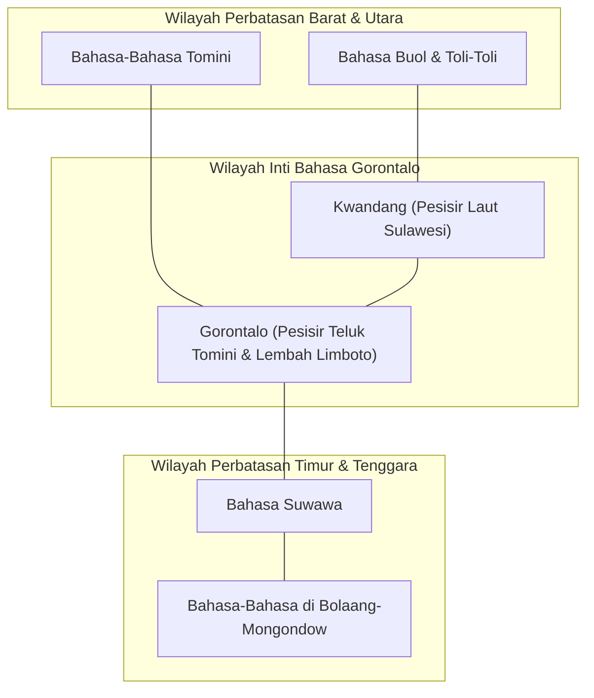

# Peta Bahasa Gorontalo dan Wilayah Persebarannya

## Informasi Kartografis Dokumen Kamus
Berdasarkan peta leksikografis/dialektologis yang disertakan pada bagian awal buku (*Kamus Bahasa Gorontalo–Indonesia*, hlm. vi / PDF hal. 7):

- **Judul Peta**: Peta Bahasa Gorontalo
- **Skala**: 1 : 18.750.000
- **Orientasi**: Peta digambarkan dengan orientasi semenanjung utara Pulau Sulawesi membentang horizontal (Utara di sebelah kanan, Barat di sebelah atas, Selatan di sebelah kiri, Timur di sebelah bawah).
- **Badan Air Pembatas**:
  - **Teluk Gorontalo / Teluk Tomini**: Membatasi pesisir selatan wilayah penutur bahasa Gorontalo.
  - **Laut Sulawesi**: Membatasi pesisir utara semenanjung wilayah Gorontalo dan Kwandang.

---

## Sebaran Bahasa dan Bahasa-Bahasa Sekitar

Wilayah semenanjung utara Sulawesi pada peta memperlihatkan batas kontak linguistik Bahasa Gorontalo dengan bahasa-bahasa Austronesia serumpun di sekitarnya:

```text
                  [ BARAT / Wilayah Barat Laut ]
                                |
             +------------------+------------------+
             |                                     |
   Bahasa-Bahasa Tomini                   Bahasa Buol Toli-Toli
   (Wilayah Teluk Tomini Barat)           (Pesisir Utara / Buol)
             |                                     |
             +------------------+------------------+
                                |
                    [ BAHASA GORONTALO ]
               Kota Gorontalo <--------> Kwandang
                                |
                                v
                       [ BAHASA SUWAWA ]
                                |
                                v
               [ BAHASA-BAHASA DI BOLAANG-MONGONDOW ]
                                |
                  [ TIMUR / Wilayah Semenanjung ]
```

### Wilayah Inti Penutur Bahasa Gorontalo:
1. **Gorontalo**: Pusat konsentrasi penutur di bagian selatan pesisir Teluk Tomini hingga pedalaman lembah Limboto.
2. **Kwandang**: Pusat konsentrasi penutur di bagian pesisir utara yang berhadapan dengan Laut Sulawesi.
3. **Bahasa Suwawa**: Wilayah penutur di bagian timur/tenggara Gorontalo (Sub-wilayah Suwawa / Bone Bolango).
4. **Wilayah Perbatasan Bahasa Lain**:
   - Di sebelah barat/barat daya: Berbatasan dengan **Bahasa-bahasa Tomini**.
   - Di sebelah barat laut: Berbatasan dengan rumpun **Bahasa Buol** dan **Toli-Toli**.
   - Di sebelah timur/tenggara: Berbatasan dengan rumpun **Bahasa-bahasa di Bolaang-Mongondow**.

---

## Representasi Diagram Kontak Bahasa


