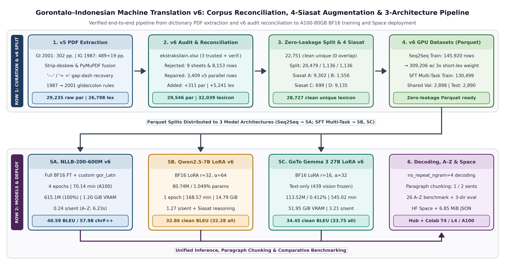
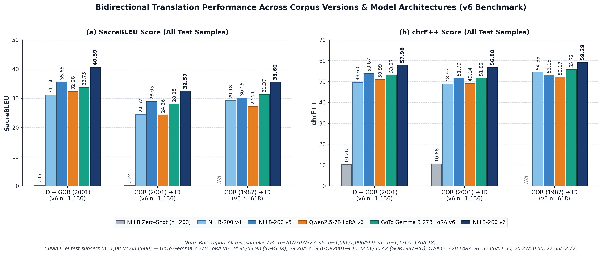
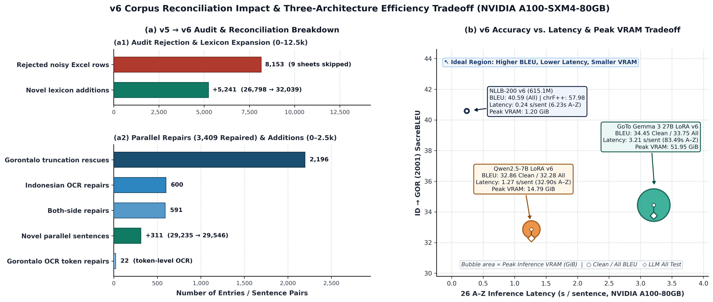

# Gorontalo–Indonesian Machine Translation v6: Selective Corpus Reconciliation, Pateda Linguistic Strategies, and a Three-Architecture Benchmark

**Authors:** Funco Tanipu, Richic Oct Sumual, Budiyanto, Thomas Jr  
**Affiliation:** Panita Research Gorontalo, Gorontalo, Indonesia  
**Website:** https://panita.web.id  
**Emails:** `{ai, richie, funco}@panita.web.id`

---

## Abstract

Building reliable machine translation between Indonesian and Gorontalo (*Bahasa Hulontalo*) faces two persistent barriers: a wide vocabulary gap between modern Indonesian and historical dictionaries, and conflicting spelling conventions between Prof. Mansoer Pateda's 1987 (*Indonesia–Gorontalo*) and 2001 (*Gorontalo–Indonesia*) dictionaries. Starting from our v5 optical character recognition (OCR) extraction (29,235 parallel sentences and 26,798 lexicon entries), we apply a strict v5-to-v6 workbook reconciliation audit that skips 9 noisy sheets, rejects 8,153 flawed rows, repairs 3,409 parallel pairs, and adds 311 sentences and 5,241 lexicon entries, reaching 29,546 raw parallel sentences and 32,039 lexicon entries. Deduplication and stratified splitting produce 22,751 zero-leakage sentences (20,479 train / 1,136 validation / 1,136 test), and four rule-based Pateda strategies applied strictly to the training split yield 145,920 sequence-to-sequence pairs (309,206 with 3x short-lexicon weighting) and 130,499 multi-task supervised fine-tuning (SFT) prompts. On one NVIDIA A100-SXM4-80GB GPU in `bfloat16`, we train and benchmark three distinct architectures: NLLB-200-distilled-600M (40.59 SacreBLEU / 57.98 chrF++ on Indonesian-to-Gorontalo; 32.57 / 56.80 on Gorontalo-2001-to-Indonesian; 35.60 / 59.29 on Gorontalo-1987-to-Indonesian), Qwen2.5-7B-Instruct LoRA (32.86 / 51.60 clean and 32.28 / 50.99 all on ID→GOR), and GoTo Gemma 3 27B CPT text-only LoRA with 439 vision tensors frozen (34.45 / 53.98 clean and 33.75 / 53.27 all on ID→GOR; 29.20 / 53.19 clean on GOR(2001)→ID). We also audit all three models across 26 A–Z root-word sentences, study paragraph chunking under `no_repeat_ngram_size=4`, and evaluate open deployment tradeoffs.

**Index Terms:** Gorontalo language, low-resource machine translation, corpus reconciliation, NLLB-200, Qwen2.5, Gemma 3, LoRA, Mansoer Pateda.

---

## I. Introduction

Gorontalo (*Bahasa Hulontalo*) is a regional Austronesian language spoken primarily in Gorontalo Province on the northern peninsula of Sulawesi, Indonesia. As national schooling, online media, and daily administration increasingly rely on standard Indonesian (*Bahasa Indonesia*), younger speakers have fewer opportunities to practice formal and everyday Gorontalo expressions. Practical digital tools—including bidirectional translators, searchable bilingual dictionaries, and grammar assistants—help keep the language accessible for daily learning and cultural preservation.

Despite strong community interest, building accurate translation models between Indonesian and Gorontalo runs into two basic obstacles. First, there is a clear **lexicon gap**: modern Indonesian uses technical, legal, and contemporary terms that rarely appear directly in older regional dictionaries. Without explicit rules for affixation and loanword sound adaptation, translation models struggle on unseen vocabulary. Second, the two main reference works compiled by Prof. Dr. H. Mansoer Pateda—the 1987 *Kamus Bahasa Indonesia–Gorontalo* [1] and the 2001 *Kamus Bahasa Gorontalo–Indonesia* [2]—follow **conflicting spelling conventions**. The 1987 dictionary marks long vowels with double letters and writes glottal stops with question marks (`?`), whereas the 2001 edition uses colons (`:`) for long vowels, drops inter-letter glottal marks, and writes glide consonants (`y`, `w`) explicitly.

Our earlier v5 release showed that automated PDF extraction and grammar-driven data augmentation substantially improve neural translation over zero-shot baselines. However, manual inspection of v5 outputs still exposed truncated Gorontalo phrases, OCR errors on the Indonesian side, and coverage gaps in rare lexicon entries. In this work, we present the complete **v6** upgrade, contributing four concrete advances:

1. **Selective v5-to-v6 workbook audit and reconciliation:** Building on our v5 layout-aware extraction of 302 lexicon pages from Pateda (2001) and 508 pages (19 introductory plus 489 lexicon pages across 26 PDFs) from Pateda (1987), our reconciliation script (`reconcile_v6_audit.py --apply`) audits external curation sheets selectively. It skips 9 problematic sheets, rejects 8,153 noisy rows, applies 3,409 verified parallel sentence repairs (including 2,196 Gorontalo truncation rescues), and adds 311 parallel sentences and 5,241 lexicon entries to reach 29,546 raw parallel rows and 32,039 lexicon entries.
2. **Zero-leakage v6 splits and Four Pateda Strategies:** Strict filtering and deduplication produce 22,751 clean unique parallel sentences (split 20,479 train / 1,136 validation / 1,136 test with zero exact-pair overlap) and 28,727 clean unique lexicon entries. Four rule-based Pateda strategies are applied solely to the training split, yielding 145,920 Seq2Seq rows (309,206 after 3x short-lexicon weighting) and 130,499 multi-task SFT prompts across 11 tasks.
3. **Three-architecture benchmark on A100-80GB:** We train and compare three distinct model families in `bfloat16`: a compact encoder–decoder translator (`NLLB-200-distilled-600M` with a custom `gor_Latn` token), a 7B parameter-efficient LLM (`Qwen2.5-7B-Instruct` LoRA), and a 27B Nusantara Continual Pre-Trained (CPT) LLM (`GoToCompany/gemma3-27b-cpt-gotoai-v3-instruct` text-only LoRA with all 439 vision/multimodal tensors frozen), beating zero-shot, v4, and v5 baselines across all test directions.
4. **Complete A–Z audit, paragraph chunking study, and hybrid deployment:** We inspect all three v6 models across 26 newly constructed A–Z sentences with exact A100 latency and peak VRAM figures, examine sentence-dropping versus repetition-loop tradeoffs on four-sentence paragraphs under `no_repeat_ngram_size=4`, and package open artifacts across Hugging Face release directories, a static browser Space, a Gradio `app.py` demo, and a Google Colab notebook.

---

## II. Linguistic Background and Related Work

### A. Pateda's 1987 and 2001 Reference Dictionaries

The primary printed sources for Indonesian–Gorontalo machine translation are two bilingual dictionaries compiled by Prof. Mansoer Pateda. The 1987 *Kamus Bahasa Indonesia–Gorontalo* [1] contains 489 lexicon pages across 26 alphabetical PDF files, preceded by 19 introductory pages describing abbreviations, phonology, and grammar. The 2001 *Kamus Bahasa Gorontalo–Indonesia* [2] covers 302 lexicon pages (pages 38–339) mapping Gorontalo headwords and derived forms to Indonesian definitions and example sentences. Combining both references yields true bidirectional coverage, provided their spelling standards are reconciled first.

### B. Orthographic Divergence: 1987 vs. 2001

Without orthographic normalization, a neural model treats identical Gorontalo words printed in 1987 and 2001 as unrelated tokens. Three systematic differences separate the two editions:

1. **Long vowels:** Doubled letters in 1987 (`aa, ee, ii, oo, uu`) become colon-marked vowels in 2001 (`a:, e:, i:, o:, u:`).
2. **Glottal stops:** Intervocalic glottal stops written as question marks (`?`) in 1987 (e.g., *wa?u* "I", *lo?otapu* "obtained") are dropped in 2001 (*wau*, *lootapu*).
3. **Glide consonants:** Implicit glides in 1987 (*tio* "he/she", *boito* "that", *mai* "hither", *wau* "and", *waatia* "I [polite]", *moali* "can") are written explicitly with `y` and `w` in 2001 (*tiyo*, *boyito*, *mayi*, *wawu*, *wa:tiya*, *mowali*).

Our curation pipeline normalizes all training targets to the 2001 standard while preserving the original 1987 strings as a dedicated reverse-translation task (`translate_gor1987_to_id`), enabling models to read both historical and modern print forms.

### C. Five-Tense/Aspect System and Morphophonemics

Gorontalo expresses tense, aspect, and spatial direction directly inside verb morphology. Pateda's grammar defines five tense/aspect categories: (1) *future/irrealis*, marked by `/m/` prefixes (`mo-`, `mopo-`, `moti-`), suffix `-lo`, or infix `-um-`; (2) *ongoing progressive*, marked by `hemo-`/`hemoti-`; (3) *present*, formed through partial or full reduplication; (4) *past progressive*, marked by `helo-`/`heloti-`; and (5) *past/completed*, marked by `/l/` prefixes (`lo-`, `lopo-`, `loti-`, `lee-`) or infix `-il-`.

Four Directional Morphemes (*Morfem Penunjuk Arah*, MPA) specify motion relative to speaker and listener: *mayi* ("toward speaker"), *mao* ("away toward listener"), *mola* ("over there / upstream"), and *mota* ("yonder / downstream"). Gorontalo also features 17 numeral classifiers, final vowel shifts (`-o` → `-a`), and predictable initial consonant assimilation when prefixes attach: `/t/→/l/`, `/s/→/n/`, `/p/→/m/`, and `/k/→/ng/` (for instance, *mo- + tuladu* → *moluladu* "to write").

### D. Three Model Families: Seq2Seq NMT, 7B LoRA, and 27B CPT LoRA

We compare three architectures suited to different translation and hardware budgets:

- **Encoder–Decoder NMT (NLLB-200):** `NLLB-200-distilled-600M` [3] translates across 200 languages using explicit source and target language tags. Because Gorontalo is missing from NLLB-200's built-in language inventory, zero-shot translation fails almost completely. Registering a custom `gor_Latn` token initialized from related Austronesian languages lets full fine-tuning specialize the 615M-parameter network efficiently.
- **Compact Instruction LLM (Qwen2.5-7B-Instruct):** Qwen2.5-7B [4] follows multi-task prompts well and can explain grammar rules alongside translations. Instead of updating all 7.6B base weights, Low-Rank Adaptation (LoRA) [5] freezes the base network and trains compact low-rank update matrices inside attention and feed-forward projections.
- **27B Nusantara CPT Text-Only LoRA (GoTo Gemma 3 27B):** Building on Google's Gemma 3 27B multimodal architecture [6], GoTo-AI-Gemma-3-27B-IT (`GoToCompany/gemma3-27b-cpt-gotoai-v3-instruct`) [7] applies Continual Pre-Training (CPT) on Indonesian and regional Nusantara languages. Because Gemma 3 wraps a SigLIP vision encoder inside a multimodal causal model, we freeze all base weights—including all 439 `vision_tower` and `multi_modal_projector` tensors—and restrict LoRA solely to the 62 text decoder layers (`model.language_model.layers.0`–`61`).

---

## III. Methodology: Extraction, v6 Reconciliation, and Four Pateda Strategies

*Fig. 1. End-to-end v6 pipeline: v5 dictionary PDF extraction, selective workbook audit and reconciliation (`reconcile_v6_audit.py --apply`), zero-leakage splitting with Four Pateda Strategies, three-architecture A100-80GB training, and deployment packaging.*

Fig. 1 outlines our complete v6 workflow from raw dictionary PDFs and spreadsheet reconciliation to GPU training and deployment artifacts.

### A. Layout-Aware v5 PDF Extraction

Our base datasets come from two custom v5 PDF extraction pipelines built to handle two-column print layouts, scan tilt, and dictionary placeholders:

- **GI 2001 Extractor (`extract_gi_v5.py`):** Inside `gorontaloindonesia/`, all 302 lexicon pages (pages 38–339) are rendered at 300 DPI grayscale, split vertically at the text-centered gutter, and straightened with *strip-deskew*—a local step that divides each column into horizontal strips and corrects slight scan slant before Tesseract 5 OCR (`-l ind+eng --psm 6`). PyMuPDF span metadata is fused with visual stroke-width and slant checks to separate Gorontalo headwords, examples, and Indonesian glosses, while reconstructing `'---'` placeholders for repeated headwords. This produces **4,246** headwords, **3,822** sub-headwords, **10,936** lexicon entries, **9,017** parallel sentences, **3,808** morphology pairs, and **32,778** base SFT prompts.
- **IG 1987 Extractor (`extract_ig_v5.py`):** Inside `indonesiagorontalo/`, processing 26 PDFs (19 introductory pages and 489 lexicon pages across letters A–Z) with OpenCV and Tesseract 5 TSV output applies local strip-deskewing within $[-4.5^\circ, +4.5^\circ]$, removes noise specks (< 5 px), detects italics via projection variance and bold text via `distanceTransform`, recovers `'= ='` headword placeholders, heals glottal `'?'` symbols, and avoids splitting Indonesian clauses at internal commas. Automated spelling rules standardize targets to 2001 notation while keeping original 1987 inputs. This yields **9,308** Indonesian headwords, **6,454** sub-headwords, **15,862** lexicon entries, **20,218** parallel sentences, **5,969** morphology pairs, and **62,267** base SFT prompts.

Merging both dictionaries gives the v5 baseline corpus: **29,235** raw parallel sentences (9,017 GI + 20,218 IG), **26,798** raw lexicon entries (10,936 GI + 15,862 IG), **9,777** morphology pairs, and **95,045** base SFT prompts.

### B. Selective v5-to-v6 Audit and Reconciliation

Inspection of v5 outputs revealed mid-sentence truncations in Gorontalo examples and residual OCR errors on the Indonesian side. To fix these defects without introducing synthetic noise, `reconcile_v6_audit.py --apply` audits an auxiliary curation workbook (`othersource/ekstraksilain.xlsx`) using strict whitelisting and automated leak guards:

- **Sheet whitelisting and blacklisting:** Only three sheets with traceable dictionary provenance are accepted: `Sheet12` (11,043 valid candidates), `GORONTALO V1` (8,175), and `INDONESIA V1` (7,276). Meanwhile, `INDONESIA 2` serves strictly as a verifier for resolving Excel `#ERROR!` cells and `= =` placeholders. Nine other sheets (`GORONTALO`, `GORONTALO-INDONESIA`, `GORONTALO SIMPLE`, `INDONESIA`, `INDONESIA GORONTALO`, unverified `INDONESIA 2`, `INDONESIA_GABUNG`, `Copy of INDONESIA_GABUNG`, and `datasetkata`) are skipped outright due to duplicates, LLM hallucinations, missing `:` vowel-length markers, or row-alignment shifts.
- **Strict row-level rejection (8,153 rows):** Candidate rows must contain only ASCII characters, pass language-identification checks on both sides, and contain no editorial placeholders, unbalanced parentheses, or formula errors. Strict guards reject **8,153** noisy rows, led inside `INDONESIA V1` by `ambiguous_eq_or_error` (3,095), `failed_bas_is_clean_parallel` (1,933), and `unverified_excel_error` (1,313).
- **Repairs to v5 parallel sentences (3,409 rows):** Reconciliation repairs **3,409** existing v5 parallel rows: **2,196** Gorontalo truncation rescues (`gor_truncation_rescue`), **600** Indonesian OCR repairs (`id_ocr_repair`), **591** dual-side repairs (`both_gor_and_id_repair`), and **22** Gorontalo token repairs (`gor_ocr_token_repair`). Across v5 splits, these updates repair 2,584 training rows, 162 validation rows, 163 test rows, and 500 previously filtered-out rows (2,115 sourced from `Sheet12`, 821 from `GORONTALO V1`, and 473 from `INDONESIA V1`), while flagging **250** uncertain Indonesian OCR edits into a manual review queue (`id_ocr_review_queue.jsonl`).
- **Curated novel additions:** Beyond repairs, reconciliation adds **+311** novel parallel sentences (242 `Sheet12`, 31 `GORONTALO V1`, 38 `INDONESIA V1`) and **+5,241** novel lexicon entries (755 `GORONTALO V1`, 4,486 `INDONESIA V1`). The reconciled raw v6 corpus totals **29,546** parallel sentences (20,498 IG 1987 + 9,048 GI 2001) and **32,039** lexicon entries (20,348 IG 1987 + 11,691 GI 2001; comprising 16,192 derived forms, 10,606 headwords, and 5,241 spreadsheet-curated entries).

### C. Zero-Leakage Stratified Splitting and Four Pateda Strategies

Next, `build_augmented_sft_dataset.py` cleans and deduplicates the reconciled v6 corpus into **22,751** clean unique parallel sentences (up from 21,939 in v5) and **28,727** clean unique lexicon entries (up from 23,486 in v5), alongside **9,269** clean morphology pairs (3,808 GI + 5,461 IG). Stratified by dictionary source with `SEED=42`, the 22,751 unique sentences split into **20,479** training (90%), **1,136** validation (5%), and **1,136** test (5%) sentences. Exact-pair overlap checks confirm zero leakage across all splits ($\text{train} \cap \text{test} = 0$, $\text{train} \cap \text{val} = 0$, $\text{val} \cap \text{test} = 0$).

To bridge vocabulary gaps without leaking validation or test examples, four rule-based strategies from Pateda's grammar are applied **strictly to the training split**:

1. **Strategy A — Morphological & Grammar Engine (9,302 items):** Combines 9,269 clean morphology derivation pairs with 33 explicit rules covering the five-tense system, MPAs, consonant assimilation, `-o` → `-a` vowel shifts, 17 classifiers, and 1987 vs. 2001 orthography.
2. **Strategy B — Loanword Phonologization (1,556 items):** Adapts consonant-final Indonesian borrowings to Gorontalo's open-vowel syllables with productive affixes (e.g., *adil* → *a:dili*, *dokter* → *dokuteri*, *adat* → *a:dati*), up from 1,341 in v5.
3. **Strategy C — Analytical Paraphrasing & MPA (699 items):** Builds directional verb combinations using *mayi, mao, mola, mota* from the 20,479 training sentences (up from 665 in v5).
4. **Strategy D — KBBI Synonym & Register Bridging (9,135 items):** Generates Indonesian synonym rewrites and ordinary (*wau/yio*) vs. polite (*wa:tiya/ito*) register pairs on the training sentences (up from 8,818 in v5).

As shown in Tables I and II, the final v6 Parquet datasets contain **145,920** Seq2Seq training pairs (**309,206** after 3x short-lexicon oversampling) and **130,499** multi-task SFT training prompts across 11 tasks, sharing identical **2,898**-row validation and **2,890**-row test sets (1,136 ID→GOR + 1,136 GOR(2001)→ID + 618 GOR(1987)→ID).

#### Table I: v5 vs. v6 Corpus Progression and Final Parquet Splits

| Dataset Stage / Split | v5 | v6 |
| :--- | ---: | ---: |
| GI 2001: Headwords / Sub-headwords | 4,246 / 3,822 | 4,246 / 3,822 |
| IG 1987: Headwords / Sub-headwords | 9,308 / 6,454 | 9,308 / 6,454 |
| Raw Unified Parallel Sentences | 29,235 | 29,546 |
| Raw Unified Lexicon Entries | 26,798 | 32,039 |
| Raw Unified Morphology Pairs | 9,777 | 9,777 |
| Repaired Parallel Rows (Reconcile) | – | 3,409 |
| Novel Parallel / Lexicon Additions | – | +311 / +5,241 |
| Audit Rejected Rows (9 Skipped) | – | 8,153 |
| Clean Unique Parallel Sentences | 21,939 | 22,751 |
| — Train / Val / Test (90/5/5%) | 19,747 / 1,096 / 1,096 | 20,479 / 1,136 / 1,136 |
| Clean Unique Lexicon Entries | 23,486 | 28,727 |
| Clean Morphology Pairs (GI + IG) | 9,269 | 9,269 |
| Strategy A: Morphology & Rules | 9,302 | 9,302 |
| Strategy B: Loanword Phonologization | 1,341 | 1,556 |
| Strategy C: Analytical Paraphrase | 665 | 699 |
| Strategy D: Synonym & Register | 8,818 | 9,135 |
| Seq2Seq Train (Base) | 131,339 | 145,920 |
| Seq2Seq Train (3x Lexicon Weight) | 270,333 | 309,206 |
| Seq2Seq Validation / Test | 2,786 / 2,791 | 2,898 / 2,890 |
| SFT Multi-Task Train | 117,333 | 130,499 |
| SFT Validation / Test | 2,786 / 2,791 | 2,898 / 2,890 |

#### Table II: Breakdown of the 130,499 Multi-Task v6 SFT Prompts

| SFT Task Name | Train Samples |
| :--- | ---: |
| `lexicon_id_to_gor` | 28,727 |
| `lexicon_gor_to_id` | 28,727 |
| `translate_id_to_gor` | 20,479 |
| `translate_gor_to_id` | 20,479 |
| `translate_gor1987_to_id` | 11,395 |
| `translate_id_to_gor_synonym` | 9,135 |
| `morphology_id_to_gor` | 5,461 |
| `morphology_derivation` | 3,808 |
| `loanword_phonologization` | 1,556 |
| `analytical_paraphrase_mpa` | 699 |
| `grammar_rule_gorontalo` | 33 |
| **Total SFT Training Prompts** | **130,499** |

---

## IV. Experimental Setup

All training and evaluation runs executed on a single **NVIDIA A100-SXM4-80GB** GPU (81,920 MiB VRAM) using PyTorch `2.14.1+cu130`, Transformers `5.22.1`, PEFT `0.21.2`, `tf32=True`, `SEED=42`, and `bfloat16` (`bf16`)—a 16-bit floating-point format that preserves the wide exponent range of 32-bit floats while halving memory footprint. To guard long runs against runtime preemptions, all training scripts share `training_resilience.py`, which validates complete checkpoints (weights, optimizer, scheduler, and JSON state), traps `SIGTERM`/`SIGUSR1` signals to save cleanly before exiting, records completion sentinels (`training_completed.json`), and caches partial test-set predictions per direction. Preflight checks also verify PEFT–`torchao` compatibility before loading multi-gigabyte checkpoints. Table III summarizes all three v6 model configurations.

### A. Model 1: NLLB-200-distilled-600M (Full Fine-Tuning)

In `train_nllb_gorontalo.py`, we extend `facebook/nllb-200-distilled-600M` (vocab size 256,205) by registering `gor_Latn` (ID `256204`; `ind_Latn` ID `256075`). Rather than random initialization, we set both input and output embeddings of `gor_Latn` to the mean of four related Austronesian tokens: `ind_Latn`, `bug_Latn`, `tgl_Latn`, and `ceb_Latn`. Short lexicon and morphology rows ($\le 3$ words) receive 3x oversampling, expanding Seq2Seq training data from 145,920 to **309,206** pairs. Training updates all **615,072,768** parameters (100%) for 4 epochs (19,328 steps) with `MAX_LENGTH=128`, batch size 64, learning rate $1.5 \times 10^{-4}$, cosine decay, 400 warmup steps, weight decay 0.01, and checkpointing every 500 steps (`save_total_limit=3`). Best checkpoint `checkpoint-14500` achieved `eval_loss=1.6410` (final `train_loss=1.1307`) in **69.44 min** for the training loop (**70.14 min** total with evaluation). On disk, weights occupy **2,460,350,816 B** (2,346 MiB / 2.3G `safetensors`, 509 `fp32` tensors; 2,377 MiB / 2.4G folder). Evaluation uses *beam search* (`num_beams=4`, `max_new_tokens=96`), which tracks four candidate sequences per step to pick the highest-scoring translation.

### B. Model 2: Qwen2.5-7B-Instruct LoRA

In `train_qwen_lora_gorontalo.py`, we adapt `Qwen/Qwen2.5-7B-Instruct` using LoRA rank $r=32$, $\alpha=64$, and dropout 0.05 across all linear attention and MLP projections (`q, k, v, o, gate, up, down_proj`), yielding **80,740,352** trainable parameters (**1.0491%** of 7,696,356,864 total; 392 LoRA tensors, 0 vision tensors). All 130,499 SFT examples use ChatML formatting with `-100` label masking over the system and user prompt. Thanks to 80 GB VRAM, training runs for 1 epoch (2,040 steps) with `MAX_SEQ_LEN=256`, batch size 64 (`grad_accum=1`, gradient checkpointing disabled), learning rate $2 \times 10^{-4}$, cosine schedule, 100 warmup steps, weight decay 0.01, and saving every 150 steps. Checkpoint `checkpoint-2040` achieved `eval_loss=1.4329` (`train_loss=1.6235`) in **164.24 min** for the training loop (**168.57 min** total). The saved adapter takes **323,014,168 B** (308 MiB / 309M `safetensors`; 319 MiB / 319M folder). Evaluation uses *greedy decoding* (`do_sample=False`, `max_new_tokens=96`), picking the top token at each step.

### C. Model 3: GoTo Gemma 3 27B CPT Text-Only BF16 LoRA

Our third training script (`train_gemma3_27b_lora_gorontalo.py`) adapts `GoToCompany/gemma3-27b-cpt-gotoai-v3-instruct` (27,545,923,184 total parameters). We freeze every base weight—including all **439** SigLIP vision and multimodal projector tensors (`vision_tower`, `multi_modal_projector`)—and apply LoRA ($r=16$, $\alpha=32$, dropout 0.05) solely to text layers `model.language_model.layers.0`–`61` via regex, yielding **113,516,544** trainable parameters (**0.4121%**; 868 LoRA tensors, 0 vision). Prompts follow the official Gemma 3 chat template (`<start_of_turn>user` / `model` / `<end_of_turn>`) with exact token-prefix `-100` masking so SentencePiece boundaries never drift, plus dual stop IDs (`eos_token_ids=[1, 106]`). Training runs in native `bf16` with `sdpa` attention, non-reentrant gradient checkpointing, loss-only evaluation (`prediction_loss_only=True`), batch size 8 x gradient accumulation 8 (effective 64), `MAX_SEQ_LEN=256`, 1 epoch (2,040 steps), learning rate $1 \times 10^{-4}$, 100 warmup steps, and saving every 100 steps. Checkpoint `checkpoint-2040` achieved the lowest validation loss among all three models (`eval_loss=1.3931`, `train_loss=1.6540`) in **535.16 min** for the training loop (**545.02 min** total). The adapter weighs **454,196,424 B** (433 MiB / 434M `safetensors`; 465 MiB / 466M folder). Evaluation uses greedy decoding (`do_sample=False`, `max_new_tokens=96`, `eos_token_ids=[1, 106]`).

#### Table III: Hyperparameter, Convergence, and Footprint Comparison Across v6 Models on 1x NVIDIA A100-SXM4-80GB (`bf16`, `SEED=42`)

| Configuration / Metric | NLLB-200-distilled-600M v6 | Qwen2.5-7B-Instruct LoRA v6 | GoTo Gemma 3 27B LoRA v6 |
| :--- | :--- | :--- | :--- |
| Base Model | `facebook/nllb-200-distilled-600M` | `Qwen/Qwen2.5-7B-Instruct` | `GoToCompany/gemma3-27b-cpt-gotoai-v3-instruct` |
| Total / Trainable Params | 615,072,768 / 615,072,768 (100%) | 7,696,356,864 / 80,740,352 (1.0491%) | 27,545,923,184 / 113,516,544 (0.4121%) |
| Adaptation Scope | Full FT + `gor_Latn` (ID 256204) | LoRA $r=32, \alpha=64$, `dropout=0.05`, 392 tensors (0 vision) | Text-only LoRA $r=16, \alpha=32$, `dropout=0.05`, 868 tensors (0 vision; 439 vision frozen) |
| Training Data | 145,920 (309,206 w/ 3x lexicon wt.) | 130,499 SFT prompts (ChatML, `-100` mask) | 130,499 SFT prompts (Gemma 3 template, `-100` mask) |
| Max Length / Batch | 128 tokens / 64 (64 x 1) | 256 tokens / 64 (64 x 1, `grad_ckpt=0`) | 256 tokens / 64 (8 x 8, `sdpa`, `grad_ckpt=1`) |
| Epochs / Steps / Best | 4 epochs / 19,328 / `ckpt-14500` | 1 epoch / 2,040 / `ckpt-2040` | 1 epoch / 2,040 / `ckpt-2040` |
| Learning Rate / Warmup | $1.5 \times 10^{-4}$ cosine / 400 steps | $2 \times 10^{-4}$ cosine / 100 steps | $1 \times 10^{-4}$ cosine / 100 steps |
| Eval Decoding | Beam search (`num_beams=4`, 96 tok) | Greedy (`do_sample=False`, 96 tok) | Greedy (`do_sample=False`, 96 tok, `eos=[1, 106]`) |
| Final `train` / Best `eval` Loss | 1.1307 / 1.6410 | 1.6235 / 1.4329 | 1.6540 / 1.3931 |
| Train Loop / Total | 69.44 / 70.14 min | 164.24 / 168.57 min | 535.16 / 545.02 min |
| `safetensors` / Folder Size | 2,346 / 2,377 MiB (2.3G / 2.4G, 509 `fp32`) | 308 / 319 MiB (309M / 319M, 392 tensors) | 433 / 465 MiB (434M / 466M, 868 tensors) |
| Inference Load / Peak VRAM | 1.1496 GiB / 1.1961 GiB | 14.4869 GiB / 14.7877 GiB | 51.5237 GiB / 51.9503 GiB |

### D. Evaluation Metrics and Clean LLM Subsets

We report two automatic metrics across all test directions: **SacreBLEU** [8], which scores standardized $n$-gram word overlap against reference translations, and **chrF++** [9] (`word_order=2`), which combines character and word $n$-gram F-scores to capture partial stem and affix matches across Gorontalo's rich morphology. For both LLMs, we report results on all test items ($n = 1,136 / 1,136 / 618$) as well as on an automated *clean* subset ($n = 1,083 / 1,083 / 600$) filtered via `is_clean_sft`, which retains pairs of 2–22 words per side with word-length ratios $\le 2.2$ while excluding rows containing residual dictionary symbols (`=`, `;`, `—`) or numbered list markers (`r"\(\d+\)|\b\d+\."`).

---

## V. Results, Qualitative Audits, and Deployment

### A. Quantitative Translation Benchmark

#### Table IV: Quantitative Benchmark Across Zero-Shot, v4, v5, and v6 Models (SacreBLEU / chrF++)

| Model & Version | Test Size ($n$) | ID→GOR (2001) SacreBLEU | ID→GOR (2001) chrF++ | GOR (2001)→ID SacreBLEU | GOR (2001)→ID chrF++ | GOR (1987)→ID SacreBLEU | GOR (1987)→ID chrF++ |
| :--- | :---: | ---: | ---: | ---: | ---: | ---: | ---: |
| NLLB-200 Zero-Shot (v6 test) | 200 / 200 / – | 0.17 | 10.26 | 0.24 | 10.66 | – | – |
| NLLB-200 v4 | 707 / 707 / 323 | 31.14 | 49.60 | 24.52 | 48.93 | 29.18 | 54.55 |
| Qwen2.5-7B LoRA v4 (All) | 707 / 707 / 323 | 25.62 | 43.27 | 18.10 | 41.78 | 21.50 | 46.23 |
| Qwen2.5-7B LoRA v4 (Clean) | 643 / 643 / 289 | 26.43 | 44.23 | 18.95 | 42.67 | 22.48 | 47.00 |
| NLLB-200 v5 | 1,096 / 1,096 / 599 | 35.65 | 53.87 | 28.95 | 51.70 | 30.15 | 53.15 |
| Qwen2.5-7B LoRA v5 (All) | 1,096 / 1,096 / 599 | 31.20 | 49.51 | 21.78 | 45.57 | 23.50 | 47.70 |
| Qwen2.5-7B LoRA v5 (Clean) | 1,026 / 1,026 / 570 | 32.07 | 50.21 | 22.94 | 47.08 | 24.19 | 48.85 |
| **NLLB-200 v6** | **1,136 / 1,136 / 618** | **40.59** | **57.98** | **32.57** | **56.80** | **35.60** | **59.29** |
| Qwen2.5-7B LoRA v6 (All) | 1,136 / 1,136 / 618 | 32.28 | 50.99 | 24.36 | 49.14 | 27.21 | 52.17 |
| Qwen2.5-7B LoRA v6 (Clean) | 1,083 / 1,083 / 600 | 32.86 | 51.60 | 25.27 | 50.50 | 27.68 | 52.77 |
| GoTo Gemma 3 27B LoRA v6 (All) | 1,136 / 1,136 / 618 | 33.75 | 53.27 | 28.15 | 51.82 | 31.37 | 55.72 |
| **GoTo Gemma 3 27B LoRA v6 (Clean)** | **1,083 / 1,083 / 600** | **34.45** | **53.98** | **29.20** | **53.19** | **32.06** | **56.42** |

*Note: Bold rows indicate overall best scores (**NLLB-200 v6**) and best LLM scores (**GoTo Gemma 3 27B LoRA v6 Clean**).*

*Fig. 2. All-sample SacreBLEU (a) and chrF++ (b) progression across NLLB-200 Zero-Shot, NLLB-200 v4/v5 baselines, and all three v6 architectures (`Qwen2.5-7B LoRA` v4/v5 scores appear in Table IV).*

Table IV, Fig. 2, and Fig. 3 report the complete quantitative benchmark and efficiency tradeoff. Zero-shot NLLB-200 scores near zero on the v6 test split (0.17 / 10.26 on ID→GOR; 0.24 / 10.66 on GOR(2001)→ID), confirming that Gorontalo requires explicit specialization. Upgrading from v5 to v6 improves every model family across every direction even on the larger test sets ($n = 1,136$ and $618$):

- **NLLB-200 v6 leads sentence translation:** NLLB-200 v6 reaches **40.59 SacreBLEU / 57.98 chrF++** on ID→GOR (+4.94 BLEU and +4.11 chrF++ over NLLB v5), **32.57 / 56.80** on GOR(2001)→ID (+3.62 / +5.10 over v5), and **35.60 / 59.29** on GOR(1987)→ID (+5.45 / +6.14 over v5). Dedicating all 4 epochs and 3x short-lexicon oversampling solely to translation with 4-beam search explains its lead over single-epoch multi-task LLMs.
- **GoTo Gemma 3 27B LoRA v6 leads among LLMs:** On clean subsets, Gemma 3 achieves **34.45 / 53.98** on ID→GOR (+1.59 BLEU over Qwen2.5-7B LoRA v6's 32.86 / 51.60), **29.20 / 53.19** on GOR(2001)→ID (+3.93 BLEU over Qwen's 25.27 / 50.50), and **32.06 / 56.42** on GOR(1987)→ID (+4.38 BLEU over Qwen's 27.68 / 52.77). Its largest relative margin appears when generating Indonesian targets, directly reflecting GoTo's Nusantara CPT Indonesian pretraining.
- **Qwen2.5-7B LoRA v6 improves cleanly over v5:** Qwen v6 rises from 31.20 / 49.51 to **32.28 / 50.99** all (clean: **32.86 / 51.60**) on ID→GOR, from 21.78 / 45.57 to **24.36 / 49.14** all (clean: **25.27 / 50.50**) on GOR(2001)→ID, and from 23.50 / 47.70 to **27.21 / 52.17** all (clean: **27.68 / 52.77**) on GOR(1987)→ID.

### B. Siasat Reasoning vs. Open-Ended Grammar Recall

While NLLB-200 acts strictly as a translator, both v6 LLMs answer Siasat linguistic prompts. Verbatim test outputs on `siasat_reasoning_samples` reveal an instructive split between rule application and open-ended theory recall:

- **Strategy A (`tuladu` → *menulis*):** Both models correctly apply `/t/→/l/` assimilation to form *moluladu*. Qwen outputs: *"Kata turunan: moluladu (Artinya: menulis) | Contoh: wau di:la mowali moluladu = aku tidak bisa menulis"*. Gemma 3 outputs: *"Kata turunan: moluladu (Artinya: menulis) | Contoh: wau di:la moluladu = aku tidak menulis"*.
- **Strategy B (`adil`):** Both adapt the consonant-final loanword to Gorontalo's open-vowel structure (*a:dili*) and generate valid derivatives (*moa:dili / a:diliyolo*). Qwen states: *"Bentuk serapan Gorontalo: a:dili | Contoh turunan: moa:dili / a:diliyolo | Kaidah: Adaptasi fonotaktik vokalis Bahasa Gorontalo dari kata 'adil' menjadi 'a:dili' (berakhiran vokal terbuka '-i')."* Gemma 3 explicitly highlights the source consonant trigger: *"Kaidah: Kata Indonesia 'adil' berakhir dengan konsonan 'l', sehingga diadaptasi ke sifat vokalis Bahasa Gorontalo dengan akhiran vokal '-i' menjadi 'a:dili'."*
- **Standard translation baseline (*"Saya pergi ke pasar kemarin."*):** Both LLMs output the exact polite translation *"Wa:tiya lo:nao ode pa:tali ola:ngo"*.
- **Honest failure on open-ended grammar recall (*"Sistem Kala Bahasa Gorontalo"*):** When prompted to explain all five tense/aspect categories with markers and examples—represented by only 33 training items out of 130,499 (0.025%) and capped at 96 evaluation tokens—**both** LLMs fail. Qwen fabricates incorrect terms (*"sekarang (sudut), masa lalu (kakali), masa depan (ma:timao)..."*) and cuts off after a colon. Gemma 3 begins a Markdown table (*"1. Kala Lampau (kala yilalumao) | akhiran -la | ... | 2. Kala Sedang Berlangsung (kala masa:tia) | awalan mo- | wau mo:nao = aku pergi | menyatakan kejadian yang sedang"*) that mislabels `-la` and truncates inside row 2. Open-ended grammatical reference therefore remains safer via deterministic corpus lookup rather than generative recall.

### C. Complete 3-Model 26-Sentence A–Z Root-Word Audit

*Fig. 3. (a) v5-to-v6 workbook reconciliation repairs, rejections, and lexicon additions; (b) v6 accuracy vs. A–Z inference latency and peak VRAM tradeoff on A100-80GB.*

#### Table V: Live A–Z Root-Word Audit (Letters A–M) on 1x NVIDIA A100-SXM4-80GB (`bf16`, `no_repeat_ngram_size=4`)

| Ltr | Root | Indonesian Sentence | NLLB-200 v6 | Qwen2.5-7B LoRA v6 | Gemma 3 27B LoRA v6 |
| :---: | :--- | :--- | :--- | :--- | :--- |
| A | ambil | Adik mengambil air minum di dapur. | Ti Ade lohama taluhe yilumolo to depula | Ti Ade lohama taluhu yilumolo to depula | Ti Ade lohama taluhe yilumolo to depula |
| B | beli | Ibu pergi membeli beras di pasar. | Ti Ma:ma mota motali pale to pa:tali | Ti Ma:ma lo:nao motali pale to pa:tali | Ti Ma:ma lo:nao lotali pale to pa:tali |
| C | cuci | Kakak sedang mencuci baju di sumur. | Ti Kaka hemohiboo boo to ali | Ti Kaka hemopohuheta boo to ali | Ti Kaka hemobubuhe boo to ali |
| D | datang | Mereka akan datang ke rumah kami besok. | Timongoliyo mo:naomayi ode bele lami lo:mbu | Timongoliyo mo:naomayi ode bele lami lo:mbu | Timongoliyo mo:naomayi ode bele lami lo:mbu |
| E | emas | Nenek menyimpan cincin emas di dalam lemari. | Ti Ne:ne molahu hualimo hulawa to delomo lamari | Ti Ne:ne lomaha hualimo hulawa to delomo lamari | Ti Ne:ne hipotihuta hualimo hulawa to delomo lamari |
| F | fakir | Kita harus membantu orang fakir dan miskin. | Ito musi momandu olo ta pakiri wawu misikini | Ito musi momandu to ta pakiri wawu misikini | Ito musi mohubode to ta pakiri wawu ta misikini |
| G | gali | Ayah menggali lubang di belakang rumah. | Ti Pa:pa lomuanga huango to dibalaka lo bele | Ti Pa:pa mongali huango to dibalaka lo bele | Ti Pa:pa mongalia huanga to dibalaka lo bele |
| H | hujan | Hari ini hujan turun sangat lebat. | Dulahe botiya didi lola:he daa | Dulahe botiya didi lohu:ata daa | Dulahe botiya didi lodehu sambe udaa |
| I | ikat | Petani itu mengikat kayu bakar dengan tali. | Ta mo:me:ngila boyito lomanggata ayu podi:o lo tali | Ta mo:mangimbawa boyito lopoa ayu podi:o lo tali | Ta mo:mitoa boyito mohutula ayu podi:o lo tali |
| J | jalan | Anak-anak berjalan menuju sekolah setiap pagi. | Ta ukeke:i mo:nao ode sikola timiidu dumodupo | Ta ukeke:i nao-nao ode sikola timiidu dumodupo | Ta ukeke:i mo:nao ode sikola timiidu dumodupo |
| K | kirim | Saya mengirim surat kepada paman kemarin. | Wa:tiya lolao tuladu ode oli Pama ola:ngo | Wa:tiya loposanangi tuladu ode oli Pama ola:ngo | Wa:tiya lolaolo tuladu ode oli Pama ola:ngo |
| L | lari | Kucing itu berlari mengejar tikus. | Tete boyito tilumeteo mohilapita udu | Tete boyito tilumetea molabita udu | Tete boyito tete-tetea mololola udu |
| M | makan | Kami sudah makan nasi dengan ikan goreng. | Ami ma hiponga:la ila wolo uponula goreng | Ami ma yilonga ila wolo uponula u hilinanga | Ami ma yilonga ila wolo uponula tinanga |

#### Table VI: Live A–Z Root-Word Audit (Letters N–Z) on 1x NVIDIA A100-SXM4-80GB (`bf16`, `no_repeat_ngram_size=4`)

| Ltr | Root | Indonesian Sentence | NLLB-200 v6 | Qwen2.5-7B LoRA v6 | Gemma 3 27B LoRA v6 |
| :---: | :--- | :--- | :--- | :--- | :--- |
| N | naik | Dia naik perahu menyeberangi sungai. | Tiyo lotitae to bulotu mobalango dutula | Tiyo lotitae to bulotu lolutula dutula | Tiyo lotitae to bulotu lobalanga dutula |
| O | obat | Adik minum obat supaya cepat sembuh. | Ti Ade mongilu wunemo alihu hua moluli | Ti Ade mongilu wunemo alihu hua moluli | Ti Ade mongilu wunemo alihu hua moluli |
| P | pergi | Saya pergi ke pasar kemarin. | Wa:tiya lo:nao ode pa:tali ola:ngo | Wa:tiya lo:nao ode pa:tali ola:ngo | Wa:tiya lo:nao ode pa:tali ola:ngo |
| Q | qari | Qari itu membaca ayat suci dengan suara merdu. | Ti Ka:li boyito hemobaca a:yati suci wolo suwara lo molingohu | Ti Kari boyito hemobaca a:yati suci lo suara mo:ndango | Ti Kori boyito hemobaca a:yati suci lo suara gaga |
| R | rumah | Rumah Pak Dula sangat bersih dan luas. | Bele lemei Dula sambe beresi wawu motanggalo | Bele lemei Dula udaa buheli wawu motanggalo | Bele lemei Dula moberesi daa wawu motanggalo |
| S | sapu | Tiap pagi halaman rumah harus disapu. | Timiidu dumodupo pa:ngo bele musi aatalo | Timiidu dumodupo pa:ngo bele musi aatalo | Timiidu dumodupo pa:ngo bele musi aatolo |
| T | tulis | Murid itu menulis cerita di papan tulis. | Anasikola boyito molulade wungguli to pa:pani | Anasikola boyito hemotulade wungguli to pa:pani | Anasikola boyito molulade wungguli to pa:pani |
| U | udang | Nelayan menangkap udang dan ikan di laut. | Ta mo:halawa moheupa hele wawu uponula to deheto | Ta mo:halawa lohama hele wawu uponula to deheto | Ta mo:halawa mohama hele wawu uponula to deheto |
| V | vonis | Hakim sudah menjatuhkan vonis kepada pencuri itu. | Ti Haki:mu ma lopodehu po:nisi ode ta mo:taoa boyito | Ti Haki:mu ma lopodutu lo ponisi to ta mo:taoa boyito | Ti Haki:mu ma lopohunema putu:sani ode ta mo:taoa boyito |
| W | waktu | Waktu sudah malam, mari kita tidur. | Ma huyi, dulolo ito motuluhu | Wakutu ma hui, dulo ito motuluhu | Ma huyi, dulo ito motuluhu |
| X | xilofon | Anak itu belajar memainkan alat musik xilofon. | Ta leikikia boyito lobala:jari moitohu hu:lalude | Ta leikikia boyito hemobala:jari momitana xilopon | Ta leikikia boyito mobala:jari mopoyitohe xilofong |
| Y | yakin | Saya yakin dia tidak bersalah. | Wa:tiya yakini tiyo di:la ototala | Wa:tiya yakin tiyo di:la ototala | Wa:tiya yakini tiyo di:la ototala |
| Z | ziarah | Kami pergi berziarah ke makam kakek. | Ami mo:nao mojiara ode ku:bulu li Ba:pu | Ami lo:nao modu:luhe ode ku:buru li Ba:pu | Ami lo:nao lojiara ode ku:buru li Ba:pu |

We ran an isolated sequential benchmark of all three v6 models on 26 newly constructed A–Z Indonesian sentences on the A100-80GB GPU in `bf16` with `no_repeat_ngram_size=4`, resetting VRAM to `0 MiB` between models:

- **NLLB-200 v6:** loads in **4.63 s** (`4.6327 s`), translates 26 sentences in **6.23 s** (`6.2271 s`; **0.2395 s/sentence**), allocating **1.1496 GiB** on load and **1.1961 GiB** peak (1,754 MiB `nvidia-smi`).
- **Qwen2.5-7B LoRA v6:** loads in **7.23 s**, translates 26 sentences in **32.90 s** (`32.9047 s`; **1.2656 s/sentence**, 5.3x slower than NLLB), allocating **14.4869 GiB** on load and **14.7877 GiB** peak (15,722 MiB `nvidia-smi`).
- **GoTo Gemma 3 27B LoRA v6:** loads in **22.34 s** (`22.3352 s`), translates 26 sentences in **83.49 s** (`83.4879 s`; **3.2111 s/sentence**, 13.4x slower than NLLB), allocating **51.5237 GiB** on load and **51.9503 GiB** peak (53,744 MiB `nvidia-smi`).

Tables V and VI show clear qualitative gains from v5 to v6 across all three models:

- **Case G truncation fixed across all 3 models:** In v5, both NLLB and Qwen stopped right after *to* (*Ti Pa:pa mongili huango to*), omitting "belakang rumah". In v6, all three models complete the full spatial clause (*to dibalaka lo bele*), reflecting the 2,196 Gorontalo truncation rescues applied in v6 reconciliation.
- **NLLB restores I and R:** Unlike NLLB v5, which dropped *tali* on **I** and *dan luas* on **R**, NLLB v6 outputs complete phrases (*podi:o lo tali* on **I**; *sambe beresi wawu motanggalo* on **R**).
- **Exact agreement and natural register:** All three agree verbatim on **D** (*Timongoliyo mo:naomayi ode bele lami lo:mbu*), **O**, and **P**, and render natural **W** (*Ma huyi, dulo/dulolo ito motuluhu* in NLLB and Gemma 3 vs. loanword *Wakutu* in Qwen) and **S** (*aatalo*/*aatolo*, fixing Qwen v5's clipped *a:lo*).
- **Distinct OOV behavior on X (*xilofon*):** NLLB substitutes a traditional Gorontalo bamboo instrument (*hu:lalude*), whereas Qwen and Gemma 3 preserve and adapt the unseen loanword (*xilopon* and *xilofong*). On **M** (*ikan goreng*), Qwen (*u hilinanga*) and Gemma 3 (*tinanga*) select native Gorontalo words for fried food instead of NLLB's loanword *uponula goreng*.

### D. Multi-Sentence Paragraph Translation and Chunking Study

#### Table VII: Live 4-Sentence Paragraph Decoding Comparison (`no_repeat_ngram_size=4`, A100-80GB `bf16`)

| Model (v6) | Mode (`direction`) | Chunk | Sents Kept | Time (s) | Observed Behavior / Key Snippet |
| :--- | :--- | :---: | :---: | ---: | :--- |
| NLLB-200 | `no_split` (`id2gor`) | None | 2 / 4 | 0.6658 | Early EOS after sent 2 (*...lohualingai londo ile:ngi*) |
| NLLB-200 | `chunk1` (`id2gor`) | 1 | 4 / 4 | 1.3979 | Full 4 sents; minor OCR-like token drift (*Ue:ngi*) |
| NLLB-200 | `no_split` (`gor2id`) | None | 2 / 4 | 0.3385 | Early EOS after sent 2 (*...pulang dari kebun*) |
| NLLB-200 | `chunk1` (`gor2id`) | 1 | 4 / 4 | 0.8665 | Full 4 sents; isolated sense errors (*sembuh*, *Besok*, *menjorok*) |
| Qwen2.5-7B LoRA | `no_split` (`id2gor`) | None | 3 / 4 | 6.6098 | Early EOS after sent 3 (*...lotitilawa to depula*) |
| Qwen2.5-7B LoRA | `chunk1` (`id2gor`) | 1 | 4 / 4 | 8.4745 | Full 4 sents cleanly translated |
| Qwen2.5-7B LoRA | `no_split` (`gor2id`) | None | 3 / 4 | 4.5590 | Early EOS after sent 3 (*...di depan rumah*) |
| Qwen2.5-7B LoRA | `chunk1` (`gor2id`) | 1 | 4 / 4 | 5.8153 | Full 4 sents; slight drift (*mengejek*, *naik mobil*) |
| GoTo Gemma 3 27B LoRA | `no_split` (`id2gor`) | None | 4 / 4 | 21.4842 | Full 4 sents cleanly translated |
| GoTo Gemma 3 27B LoRA | `chunk1` (`id2gor`) | 1 | 4 / 4 | 21.1584 | Full 4 sents cleanly translated |
| GoTo Gemma 3 27B LoRA | `no_split` (`gor2id`) | None | 4 / 4 | 9.5538 | Full 4 sents (drops final period; *beristirahat*) |
| GoTo Gemma 3 27B LoRA | `chunk1` (`gor2id`) | 1 | 4 / 4 | 13.8843 | Sent 4 loops (*Berdekap-dekap kami berdekap- berdekap berdekap...*) |
| GoTo Gemma 3 27B LoRA | `auto_chunk2` (`gor2id`) | 2 | 4 / 4 | 11.9127 | Full 4 sents, loop-free and coherent |

Because all training examples are single sentences capped at 128 tokens (NLLB) or 256 tokens (LLMs), feeding multi-sentence paragraphs unsplit exposes distinct failure modes. We tested all three v6 models on two 4-sentence narrative paragraphs (one `id2gor`, one `gor2id`) under `no_repeat_ngram_size=4`, comparing unsplit decoding (`max_new_tokens=256`) against sentence-level chunking (`max_new_tokens=192`), summarized across all 13 decoding runs in Table VII:

- **Early EOS without splitting (NLLB & Qwen):** When fed four sentences together, NLLB-200 drops sentences 3 and 4 in both directions (0.67 s `id2gor`, 0.34 s `gor2id`), while Qwen2.5-7B drops sentence 4 in both directions (6.61 s `id2gor`, 4.56 s `gor2id`). Setting `sentences_per_chunk=1` restores all 4 sentences for both models, though single-sentence NLLB `gor2id` exhibits sense drift (*tilumodu* → *sembuh*, *Lo:lolango* → *Besok*, *longaa* → *menjorok*) when surrounding context is absent.
- **Context loss vs. chunking size on Gemma 3 27B:** Gemma 3 preserves all four sentences even when unsplit (21.48 s `id2gor`, 9.55 s `gor2id`). Surprisingly, forcing `chunk=1` on `gor2id` strips discourse context from sentence 4 (*Lo:lolango amiya:tiya longaa...*) and triggers a hyphen-split repetition loop (*"Berdekap-dekap kami berdekap- berdekap berdekap sama-sama dengan pacar di halaman rumah."*) that evades 4-gram blocking through punctuation variants. Grouping **2 sentences per chunk** (`auto_chunk2`, 11.91 s) eliminates this loop while retaining full 4-sentence coverage. Our CLI (`infer_gorontalo.py`) therefore sets `sentences_per_chunk=2` for `gemma3 gor2id` and `1` elsewhere.

### E. Deployment Feasibility and Hybrid Space Package

Deploying three models ranging from 615M to 27.5B parameters requires matching each model to realistic hardware tiers:

- **HF Space Free Tier (`CPU Basic`: 2 vCPU / 16 GB RAM):** Only **NLLB-200 v6** (2.3G `safetensors`, 2.4G folder; $\approx 3.32$ GB peak RAM in `fp32`, 1–3 s/sentence on 2 CPU threads) fits inside the 16 GB ceiling. Both LLMs exceed 16 GB RAM even in `bf16` (14.79 GiB and 51.95 GiB peak VRAM, or $\approx 30$–$102$ GB in `fp32`), and 4-bit `bitsandbytes` requires CUDA.
- **CUDA GPU & Colab Tiers:** Qwen2.5-7B LoRA runs comfortably on free Google Colab or HF `T4 Small` (16 GB VRAM) using 4-bit NF4 quantization ($\approx 5.5$ GB VRAM), and natively in `bf16` on `L4`/`A10G` (24 GB). GoTo Gemma 3 27B LoRA requires `L4` (24 GB, $\approx 18$ GB in 4-bit QLoRA) or `A100` (80 GB, 51.95 GiB in `bf16`).
- **Prepared Hugging Face Release Package:** We locally synchronized and verified all v6 artifacts under the `panitagorontalo/` namespace: NLLB (`nllb-200-gorontalo-bi-600M`), Qwen (`qwen2.5-7b-gorontalo-lora`), Gemma 3 (`gemma3-27b-gotoai-gorontalo-lora`), and the hybrid Space (`penerjemah-bahasa-gorontalo`, `sdk: static`, `apache-2.0`). The 10.85 MiB (11,376,600 B; `11M`) `hf_space_gorontalo/` package bundles a static browser app (`index.html` and the 6.85 MiB [7,182,113 B; `6.9M`] `corpus_gorontalo.json` file holding 32,039 lexicon, 29,546 parallel, and 9,777 morphology entries), Parquet tables (`lexicon.parquet` at 1.07 MiB / 1.1M, `parallel_sentences.parquet` at 2.43 MiB / 2.5M, and `morphology.parquet` at 0.35 MiB / 357K), a chunked Gradio neural server (`app.py`), and a ready-to-run Colab notebook (`Tutorial_Penerjemah_AI_Bahasa_Gorontalo_Panita_Research.ipynb`). Both `index.html` and `app.py` passed local verification in headless Chromium and Gradio 6.31.0.

---

## VI. Limitations

We document seven transparent limitations of this v6 release:

1. **Dictionary-centered domain:** Despite spreadsheet expansion (+311 parallel, +5,241 lexicon), training data remains anchored in Pateda's 1987 and 2001 dictionaries and under-represents daily conversation, journalism, and social media prose.
2. **Residual OCR errors and rule-filtered subsets:** Even after 3,409 repairs and 8,153 rejections, minor OCR typos remain in reference strings (e.g., *mesii*, *kalaw*, *byi*, *———saya mim*). Moreover, the 250 uncertain rows in `id_ocr_review_queue.jsonl` await manual review, and LLM *clean* subsets (1,083/600) are filtered programmatically rather than hand-audited.
3. **Sentence-level training horizon and theory recall:** Models train on single sentences (128/256 tokens), causing unsplit paragraphs to drop trailing sentences in NLLB/Qwen and single-sentence chunking to trigger rare hyphenated loops in Gemma 3 `gor2id`. Both LLMs also hallucinate or truncate on open-ended grammar questions (*"Sistem Kala"*) due to having only 33 rule rows in SFT (0.025%).
4. **Dictionary vs. informal spelling:** Target standardization uses colon-marked long vowels (`:`), which matches academic dictionaries rather than casual online Gorontalo typing.
5. **Polysemy and context-free disambiguation:** Homographs and idioms without wider context remain error-prone during sentence-level translation (e.g., NLLB `gor2id` rendering *tilumodu* as *sembuh* or *Lo:lolango* as *Besok*).
6. **Modest scale and automated augmentation:** With 22,751 clean unique parallel sentences, corpus scale remains small by modern LLM standards, and Strategies A–D (9,302; 1,556; 699; 9,135) rely on programmatic rules without exhaustive native-speaker review.
7. **Automatic metrics and 27B hardware demand:** Reported SacreBLEU and chrF++ scores evaluate against single-reference dictionary pairs without formal human adequacy or fluency ratings, while the strongest LLM (`GoTo Gemma 3 27B`) still requires server-class GPUs ($\ge 24$ GB 4-bit QLoRA or $80$ GB `bf16`).

---

## VII. Conclusion and Future Work

We presented the Gorontalo–Indonesian v6 curation pipeline and three-architecture benchmark. By combining selective workbook reconciliation (3,409 parallel repairs, +311 sentences, +5,241 lexicon entries, and 8,153 rejected noisy rows) with zero-leakage splitting (22,751 clean sentences) and Four Pateda Linguistic Strategies, all three v6 models surpass zero-shot, v4, and v5 baselines. NLLB-200-distilled-600M v6 achieves the highest sentence translation scores (40.59 SacreBLEU / 57.98 chrF++ ID→GOR; 32.57 / 56.80 GOR(2001)→ID; 35.60 / 59.29 GOR(1987)→ID) at 0.24 s/sentence and 1.20 GiB peak VRAM, fitting free 16 GB CPU hosting. Among LLMs, GoTo Gemma 3 27B text-only LoRA achieves stronger translation accuracy (34.45 / 53.98 clean ID→GOR; 29.20 / 53.19 GOR(2001)→ID) and unsplit paragraph cohesion, while Qwen2.5-7B LoRA offers a balanced 4-bit T4 option (32.86 / 51.60 clean) with explicit Siasat A/B explanations. All three v6 models also resolve v5's A–Z case G truncation.

Future work will focus on: (1) human adequacy, fluency, and register evaluation by native Gorontalo linguists; (2) collecting multi-sentence conversational, literary, and news corpora; (3) manually resolving the 250-item Indonesian OCR review queue and full test split; and (4) discourse-level training to eliminate chunking boundaries.

---

## References

[1] M. Pateda, *Kamus Bahasa Indonesia–Gorontalo*. Jakarta, Indonesia: Pusat Pembinaan dan Pengembangan Bahasa, Departemen Pendidikan dan Kebudayaan, 1987.  
[2] M. Pateda, *Kamus Bahasa Gorontalo–Indonesia*, 1st ed., Seri BP No. 5304. Jakarta, Indonesia: Pusat Bahasa, Departemen Pendidikan Nasional and Balai Pustaka, 2001, ISBN 979-666-638-3.  
[3] NLLB Team (M. R. Costa-jussà et al.), "No Language Left Behind: Scaling Human-Centered Machine Translation," *arXiv preprint arXiv:2207.04672*, 2022.  
[4] Qwen Team (A. Yang et al.), "Qwen2.5 Technical Report," *arXiv preprint arXiv:2412.15115*, 2024.  
[5] E. J. Hu, Y. Shen, P. Wallis, Z. Allen-Zhu, Y. Li, S. Wang, L. Wang, and W. Chen, "LoRA: Low-Rank Adaptation of Large Language Models," in *Proc. International Conference on Learning Representations (ICLR)*, 2022, arXiv:2106.09685.  
[6] Gemma Team (A. Kamath et al.), "Gemma 3 Technical Report," *arXiv preprint arXiv:2503.19786*, 2025.  
[7] PT GoTo Gojek Tokopedia Tbk and AI Singapore, "GoTo-AI-Gemma-3-27B-IT," `GoToCompany/gemma3-27b-cpt-gotoai-v3-instruct`, Hugging Face Hub, 2025. Available: https://huggingface.co/GoToCompany/gemma3-27b-cpt-gotoai-v3-instruct.  
[8] M. Post, "A Call for Clarity in Reporting BLEU Scores," in *Proc. Third Conference on Machine Translation (WMT)*, 2018.  
[9] M. Popović, "chrF++: Words Helping Character n-Grams," in *Proc. Second Conference on Machine Translation (WMT)*, Copenhagen, Denmark, 2017.
