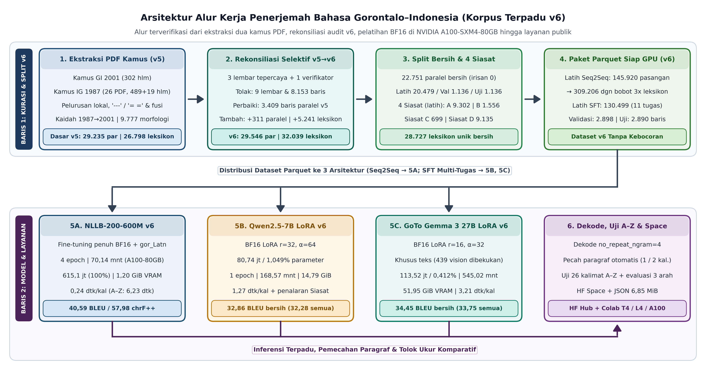
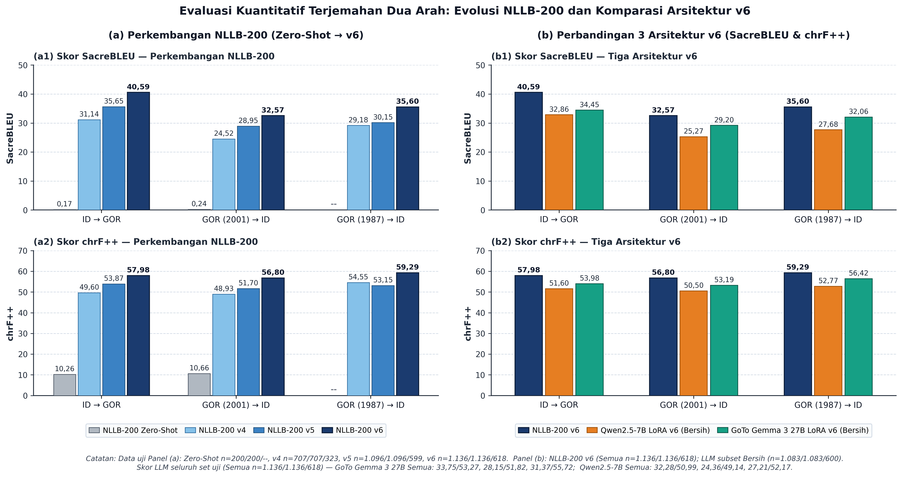
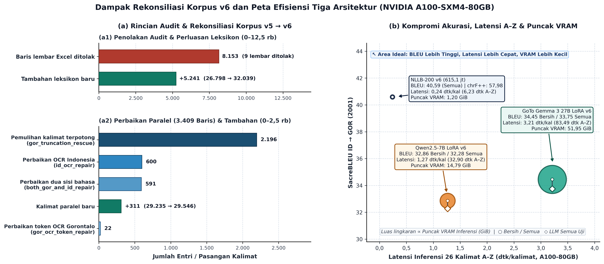

# Rekonsiliasi Korpus Terpadu v6, Empat Siasat Pateda, dan Tolok Ukur Tiga Arsitektur untuk Penerjemah Dua Arah Bahasa Indonesia–Gorontalo

**Funco Tanipu, Richic Oct Sumual, Budiyanto, Thomas Jr**  
Panita Research Gorontalo, Gorontalo, Indonesia  
Situs Web: [https://panita.web.id](https://panita.web.id) | Email: `{ai, richie, funco}@panita.web.id`

---

## Abstrak

Pengembangan penerjemah mesin dua arah Bahasa Indonesia–Gorontalo menghadapi dua hambatan utama: kesenjangan kosakata antara Bahasa Indonesia modern dan kamus daerah historis, serta perbedaan ejaan antara dua kamus karya Prof. Mansoer Pateda terbitan 1987 dan 2001. Bertolak dari korpus ekstraksi optis (OCR) versi v5 (29.235 kalimat paralel dan 26.798 leksikon), makalah ini menyajikan audit dan rekonsiliasi data selektif versi **v6**. Proses ini menolak 9 lembar bermasalah beserta 8.153 baris kotor, memperbaiki **3.409** baris paralel v5 (termasuk **2.196** pemulihan kalimat terpotong), serta menambah **+311** kalimat paralel dan **+5.241** leksikon baru menjadi **29.546** kalimat paralel dan **32.039** leksikon mentah. Pembersihan dan pemisahan tanpa kebocoran data (*zero-leakage split*) menghasilkan **22.751** kalimat paralel unik bersih (20.479 latih / 1.136 validasi / 1.136 uji; irisan 0) dan **28.727** leksikon unik bersih. Pengayaan dengan Empat Siasat Pateda khusus pada bagian latih membentuk **145.920** pasangan *Seq2Seq* (309.206 setelah bobot 3× frasa pendek) dan **130.499** instruksi SFT pada 11 tugas (2.898 validasi, 2.890 uji). Pada satu GPU **NVIDIA A100-SXM4-80GB** berpresisi `bfloat16`, kami melatih tiga arsitektur: `NLLB-200-distilled-600M` (**40,59 SacreBLEU / 57,98 chrF++** ID→GOR dari *zero-shot* 0,17 / 10,26; **32,57 / 56,80** GOR 2001→ID; **35,60 / 59,29** GOR 1987→ID), `Qwen2.5-7B-Instruct` LoRA (32,86 / 51,60 bersih; 32,28 / 50,99 semua), dan `GoToCompany/gemma3-27b-cpt-gotoai-v3-instruct` LoRA khusus teks dengan 439 tensor *vision tower* dibekukan (**34,45 / 53,98** bersih; 33,75 / 53,27 semua; **29,20 / 53,19** GOR 2001→ID). Uji 26 kalimat A–Z (6,23 detik / 1,20 GiB; 32,90 detik / 14,79 GiB; 83,49 detik / 51,95 GiB), uji *chunking* paragraf 4 kalimat, serta sinkronisasi lokal Space hibrida (`corpus_gorontalo.json` 6,85 MiB, Gradio 6.31.0, Chromium) memvalidasi kesiapan layanan publik v6.

**Kata Kunci:** Bahasa Gorontalo, penerjemahan mesin minim sumber daya, rekonsiliasi korpus, NLLB-200, Qwen2.5, Gemma 3, GoTo-AI, LoRA, Mansoer Pateda.

---

## I. Pendahuluan

Bahasa Gorontalo (*Bahasa Hulontalo*) merupakan bahasa ibu bagi masyarakat di Provinsi Gorontalo dan wilayah Teluk Tomini di semenanjung utara Sulawesi. Seperti bahasa daerah lain di Indonesia, bahasa ini memiliki tata bahasa yang sangat teratur, mulai dari penanda waktu (kala) di dalam imbuhan kata kerja, ragam sapaan hormat dan biasa, hingga penunjuk arah gerak. Namun, seiring dominasi Bahasa Indonesia baku di pendidikan, media daring, dan administrasi, penutur muda makin jarang memakai kosakata Gorontalo secara utuh. Dalam kajian pemrosesan bahasa alami (*Natural Language Processing* / NLP), Bahasa Gorontalo tergolong bahasa berdaya sumber rendah (*low-resource*, yakni bahasa yang belum memiliki banyak pasangan kalimat digital sejajar untuk melatih kecerdasan buatan). Akibatnya, model penerjemah multibahasa modern yang diuji langsung tanpa pelatihan khusus (*zero-shot*) nyaris tidak mampu menerjemahkan kalimat Gorontalo secara bermakna.

Membangun penerjemah otomatis Bahasa Indonesia–Gorontalo bukan sekadar menambah jumlah kalimat, melainkan mengatasi dua hambatan struktural sekaligus. Pertama, terdapat **kesenjangan kosakata** antara istilah Bahasa Indonesia modern dan kamus daerah historis, sedangkan dua rujukan paling berwibawa masih berbentuk buku cetak karya Prof. Dr. H. Mansoer Pateda: *Kamus Bahasa Indonesia–Gorontalo* (1987) [1] dan *Kamus Bahasa Gorontalo–Indonesia* (2001) [2]. Kedua kamus memakai aturan ejaan yang berbeda, sarat singkatan cetak, dan memiliki halaman miring atau pudar akibat usia. Oleh sebab itu, pembacaan citra halaman otomatis (*Optical Character Recognition* / OCR) mudah memotong kalimat di tepi kolom atau memicu salah baca huruf. Kedua, Bahasa Gorontalo bersifat vokalis ketat dan memberlakukan perubahan konsonan awal saat kata dasar berimbuhan, sehingga terjemahan harfiah tanpa kaidah Pateda sering meleset.

Pada versi sebelumnya (v5), kami telah membangun jalur ekstraksi OCR resolusi tinggi dan melatih dua model (`NLLB-200` dan `Qwen2.5-7B LoRA`). Namun, pemeriksaan kualitatif menyingkap bahwa sebagian kalimat contoh kamus masih terpotong akibat patah kolom cetak atau menyisakan salah baca OCR, sementara cakupan kosakata serapan modern masih perlu ditambah. Makalah ini melaporkan pembaruan menyeluruh ke versi **v6** melalui rekonsiliasi korpus selektif dan perluasan tolok ukur ke tiga keluarga arsitektur, termasuk model Nusantara `GoToCompany/gemma3-27b-cpt-gotoai-v3-instruct`. Empat kontribusi utama penelitian ini meliputi:

1. **Audit dan Rekonsiliasi Korpus Terpadu v6**: Berangkat dari korpus v5 (302 halaman Kamus GI 2001 dan 19+489 halaman Kamus IG 1987), kami melakukan rekonsiliasi data selektif atas lembar kerja kurasi tambahan (`ekstraksilain.xlsx`): hanya 3 lembar tepercaya dan 1 lembar verifikator diterima, sedangkan 9 lembar bermasalah dan 8.153 baris rusak ditolak. Proses ini memperbaiki **3.409** baris paralel v5 (termasuk **2.196** pemulihan kalimat terpotong) serta menambah **+311** paralel dan **+5.241** leksikon baru menjadi **29.546** kalimat paralel dan **32.039** leksikon mentah.
2. **Split Tanpa Kebocoran dan Empat Siasat Pateda v6**: Penyaringan dan deduplikasi ketat menyisakan **22.751** kalimat paralel unik bersih (dibagi 90% / 5% / 5% menjadi 20.479 latih, 1.136 validasi, dan 1.136 uji dengan irisan nol) serta **28.727** leksikon unik bersih. Pengayaan Empat Siasat Pateda khusus pada bagian latih menghasilkan **145.920** pasangan *Seq2Seq* (**309.206** dengan bobot 3×) dan **130.499** instruksi SFT multi-tugas.
3. **Tolok Ukur Tiga Arsitektur di GPU A100**: Pada satu GPU NVIDIA A100-SXM4-80GB (`bfloat16`), kami melatih model penerjemah khusus (`NLLB-200-distilled-600M` bertoken `gor_Latn`), LLM global (`Qwen2.5-7B-Instruct` LoRA), dan LLM Nusantara (`GoToCompany/gemma3-27b-cpt-gotoai-v3-instruct` dengan LoRA khusus teks dan 439 tensor *vision tower* dibekukan), lengkap dengan pembandingan terhadap *zero-shot*, v4, dan v5.
4. **Uji 26 Kalimat A–Z, Studi *Chunking* Paragraf, dan Paket Space**: Kami menguji ketiga model pada 26 kalimat A–Z (mencatat pemulihan kasus **G**, latensi, dan puncak VRAM), menganalisis pemecahan paragraf 4 kalimat (*chunking*) pada 13 skenario uji, serta menyinkronkan dan memverifikasi paket Space hibrida secara lokal di Gradio 6.31.0 dan peramban Chromium.

---

## II. Latar Belakang Linguistik dan Pekerjaan Terkait

### A. Kamus Rujukan Pateda 1987 dan 2001

Landasan leksikografi penelitian ini adalah dua kamus utama karya Prof. Dr. H. Mansoer Pateda yang terbit berselang empat belas tahun. Pertama, *Kamus Bahasa Indonesia–Gorontalo* (IG 1987) [1] terbitan Pusat Pembinaan dan Pengembangan Bahasa (1987), yang memuat 19 halaman pengantar kaidah fonemik-morfologis serta 489 halaman leksikon dalam 26 berkas PDF abjad A–Z. Kedua, *Kamus Bahasa Gorontalo–Indonesia* (GI 2001) [2] terbitan Pusat Bahasa dan Balai Pustaka (2001), yang memuat 302 halaman leksikon (hlm. 38–339) untuk memetakan kata dasar, bentuk turunan, dan kalimat contoh Gorontalo ke Bahasa Indonesia. Menggabungkan keduanya memberi cakupan dua arah yang jauh lebih lengkap setelah perbedaan ejaannya diselaraskan.

### B. Tiga Perbedaan Ortografi: Ejaan 1987 vs. Ejaan 2001

Meskipun mendokumentasikan Bahasa Gorontalo yang sama, terdapat tiga perbedaan ejaan (ortografi) yang sangat memengaruhi pelatihan model neural:

- **Penulisan Vokal Panjang**: Ejaan 1987 menuliskan vokal panjang dengan huruf ganda (`aa, ee, ii, oo, uu`), seperti *paatali* (pasar) dan *waatia* (saya). Sebaliknya, ejaan 2001 memakai tanda titik dua setelah vokal (`a:, e:, i:, o:, u:`), menjadi *pa:tali* dan *wa:tiya*.
- **Penulisan Hentian Glotal**: Ejaan 1987 menuliskan bunyi hentian glotal di tengah kata memakai tanda tanya (`?`), misalnya *wa?u* (aku) dan *lo?otapu* (memperoleh). Pada ejaan 2001, tanda `?` dihilangkan menjadi *wau* dan *lootapu*.
- **Huruf Luncuran *y* dan *w***: Ejaan 1987 tidak menuliskan bunyi luncuran antarvokal, sedangkan ejaan 2001 menuliskannya eksplisit: *waatia* → *wa:tiya*, *tio* → *tiyo* (dia), *boito* → *boyito* (itu), *botia* → *botiya* (ini), *mai* → *mayi* (ke sini), *wau* → *wawu* (dan), serta *moali* → *mowali* (boleh/menjadi).

Tanpa penyelarasan, model akan menganggap *waatia* dan *wa:tiya* sebagai dua kata asing. Oleh sebab itu, seluruh keluaran standar korpus v6 dibakukan ke ejaan 2001, sedangkan masukan ejaan 1987 tetap disimpan sebagai tugas terjemahan balik khusus agar model mampu membaca naskah lama.

### C. Lima Sistem Kala, MPA, dan Kaidah Morfofonemik

Tata bahasa Gorontalo menuntut pemahaman struktur kata, bukan sekadar hafalan kamus. Pertama, bahasa ini bersifat *vokalis*, artinya kata pada dasarnya harus berakhir dengan huruf vokal (*a, i, u, e, o*). Kata serapan berakhiran konsonan akan mendapat tambahan vokal akhir, misalnya *adil* menjadi *a:dili* dan *dokter* menjadi *dokuteri*. Kedua, kata kerja Gorontalo menandai waktu dan berlangsungnya peristiwa lewat **lima sistem kala** Pateda:

1. **Kala Akan**: ditandai bunyi `/m/` seperti awalan `mo-`, `mopo-`, `moti-`, akhiran `-lo`, atau sisipan `-um-`.
2. **Kala Sedang Masih**: ditandai awalan `hemo-` atau `hemoti-`.
3. **Kala Sedang**: ditandai pengulangan kata (reduplikasi).
4. **Kala Sedang Lampau**: ditandai awalan `helo-` atau `heloti-`.
5. **Kala Lampau**: ditandai bunyi `/l/` seperti awalan `lo-`, `lopo-`, `loti-`, `lee-`, atau sisipan `-il-`.

Selain itu, terdapat empat **Morfem Penunjuk Arah (MPA)** (*mayi* "ke arah pembicara", *mao* "ke lawan bicara", *mola* "ke sana", *mota* "ke tempat lain"), **17 kata bantu bilangan**, pergeseran vokal akhir (`-o → -a`), serta peluluhan konsonan awal saat berimbuhan (`/t/→/l/`, `/s/→/n/`, `/p/→/m/`, `/k/→/ng/`, seperti *mo- + tuladu* → *moluladu* "menulis").

### D. Tiga Keluarga Model: NMT Ringkas vs. LLM Global vs. LLM CPT Nusantara

Tolok ukur v6 membandingkan tiga arsitektur yang mewakili ragam skala, spesialisasi bahasa, dan kebutuhan perangkat keras:

- **NMT Khusus (`NLLB-200-distilled-600M`)** [3]: Model penerjemah saraf (*Neural Machine Translation* / NMT) berarsitektur *encoder–decoder* yang membaca makna kalimat sumber secara utuh lalu menyusun terjemahan kata demi kata pada 200 bahasa. Karena Gorontalo belum terdaftar di dalamnya, skor *zero-shot*-nya nyaris nol. Dengan mendaftarkan token baru `gor_Latn` yang diinisialisasi dari bahasa serumpun, seluruh 615 juta bobotnya difokuskan penuh untuk terjemahan cepat.
- **LLM Global dengan Adaptor LoRA (`Qwen2.5-7B-Instruct`)** [4]: Model bahasa besar (*Large Language Model* / LLM) berkapasitas 7,7 miliar parameter yang luwes mengikuti instruksi beragam. Agar pelatihan hemat memori pada satu GPU, kami memakai *LoRA* (*Low-Rank Adaptation*) [5], yakni membekukan bobot asli model dan hanya melatih pasangan matriks adaptor berperingkat rendah (sekitar 1% parameter) di proyeksi atensi dan umpan-maju.
- **LLM CPT Nusantara dengan LoRA Khusus Teks (`GoToCompany/gemma3-27b-cpt-gotoai-v3-instruct`)** [6], [7]: Model berkapasitas 27,5 miliar parameter yang dibangun di atas arsitektur multimodal Gemma 3 [6] oleh PT GoTo Gojek Tokopedia Tbk dan AI Singapore melalui tahap *Continued Pretraining* (CPT) [7], yaitu pelatihan lanjutan agar model lebih memahami kosakata dan struktur Bahasa Indonesia serta bahasa Nusantara (Jawa, Sunda, Batak Toba, dan Bali). Karena arsitektur Gemma 3 menyertakan pengode citra SigLIP, kami membekukan seluruh **439 tensor *vision tower* dan proyektor multimodal** beserta bobot dasar, lalu menempelkan adaptor LoRA hanya ke lapisan bahasa teks agar pelatihan terfokus murni pada penerjemahan dan kaidah Pateda.

---

## III. Metodologi: Rekonsiliasi Korpus v6 dan Empat Siasat Pateda

*Gambar 1. Arsitektur alur kerja terpadu v6: ekstraksi PDF dua kamus cetak (v5), audit dan rekonsiliasi data v5→v6, pembersihan dan pengayaan 4 Siasat Pateda tanpa kebocoran data, pelatihan tiga keluarga model di GPU A100-80GB (`NLLB-200`, `Qwen2.5-7B LoRA`, dan `GoTo Gemma 3 27B LoRA`), hingga strategi decoding/chunking, uji 26 kalimat A–Z, dan paket layanan publik (`mnt` = menit, `dtk` = detik).*

Alur menyeluruh penelitian versi v6—dari pembacaan kamus cetak, audit rekonsiliasi lembar kurasi, pengayaan Empat Siasat Pateda, hingga pelatihan dan verifikasi layanan publik—dirangkum pada Gambar 1.

### A. Ekstraksi PDF Dua Kamus Cetak (Fondasi v5)

Jalur ekstraksi v5 memproses masing-masing kamus sesuai tata letak fisiknya untuk menjaga batas kolom dan penanda lema:

- **Kamus GI 2001 (302 halaman leksikon, hlm. 38–339, termasuk 18 halaman pudar)**: Halaman dirender 300 DPI skala abu-abu, dibelah dua tepat di celah kepadatan teks, lalu diluruskan per pita horizontal (*strip-deskew* lokal) sebelum dibaca Tesseract 5 (`-l ind+eng --psm 6`). Sistem memadukan gaya huruf PyMuPDF dengan kemiringan dan lebar goresan visual untuk memisahkan contoh Gorontalo (cetak miring) dari terjemahan Indonesia (cetak tegak), memulihkan tanda garis hubung tiga (`---`), dan mengekspansi singkatan. Hasilnya adalah **4.246** lema pokok, **3.822** sub-lema, **10.936** leksikon, **9.017** kalimat paralel, **3.808** pasangan morfologi, dan **32.778** instruksi SFT dasar.
- **Kamus IG 1987 (26 berkas PDF: 19 halaman pengantar + 489 halaman leksikon A–Z)**: Diproses di CPU memakai OpenCV dan Tesseract 5 berformat TSV (*Tab-Separated Values*, keluaran per kata beserta koordinat dan nilai keyakinan). Pelurusan pita lokal bekerja pada rentang −4,5° hingga +4,5°, bintik < 5 piksel dibersihkan, huruf miring dideteksi via variansi proyeksi dan huruf tebal via `distanceTransform`, tanda celah `= =` dipulihkan tanpa memotong klausa Indonesia di koma, tanda glotal `?` dijaga, dan ejaan 1987 dikonversi ke 2001 sambil menyimpan bentuk aslinya. Hasilnya adalah **9.308** lema Indonesia, **6.454** sub-lema, **15.862** leksikon, **20.218** kalimat paralel, **5.969** pasangan morfologi, dan **62.267** instruksi SFT dasar.

Penggabungan awal keduanya membentuk korpus dasar v5 berisi **29.235** kalimat paralel, **26.798** leksikon dwibahasa, **9.777** pasangan morfologi, dan **95.045** instruksi dasar.

### B. Audit Selektif dan Rekonsiliasi Korpus v5 → v6

Pemeriksaan lanjutan terhadap v5 memperlihatkan kalimat contoh yang terpotong di tepi kolom PDF atau menyisakan derau OCR. Untuk memperbaikinya tanpa memasukkan derau baru, kami menjalankan **rekonsiliasi data** (pencocokan silang dan penambalan data OCR terhadap lembar kerja terkurasi) memakai skrip `reconcile_v6_audit.py --apply` atas berkas `othersource/ekstraksilain.xlsx`.

Audit dilakukan secara selektif dengan penjagaan ketat. Dari seluruh lembar kerja, skrip hanya memberi daftar putih (*whitelist*) pada **tiga lembar tepercaya**—`Sheet12` (11.043 kandidat), `GORONTALO V1` (8.175 kandidat), dan `INDONESIA V1` (7.276 kandidat)—serta memakai `INDONESIA 2` semata sebagai verifikator untuk memeriksa galat rumus `#ERROR!` dan ekspansi tanda `= =`. Sebaliknya, **sembilan lembar bermasalah ditolak**, meliputi lembar `GORONTALO`, varian `GORONTALO-INDONESIA` dan `GORONTALO SIMPLE`, lembar `INDONESIA`, `INDONESIA GORONTALO`, salinan mentah `INDONESIA 2`, `INDONESIA_GABUNG`, `Copy of INDONESIA_GABUNG`, serta `datasetkata`, karena mengandung duplikasi massal, pergeseran baris, hilangnya titik dua `:`, atau teks halusinasi LLM. Pada tingkat baris, **8.153** baris kotor ditolak otomatis (terbanyak di `INDONESIA V1`: `ambiguous_eq_or_error` 3.095, `failed_bas_is_clean_parallel` 1.933, dan `unverified_excel_error` 1.313).

Sebagaimana tergambar pada Gambar 3(a), audit v5→v6 (dengan cadangan v5 tetap tersimpan aman) menghasilkan tiga capaian inti:

1. **Perbaikan 3.409 Baris Paralel v5**: Sebanyak 2.115 baris diperbaiki dari `Sheet12`, 821 dari `GORONTALO V1`, dan 473 dari `INDONESIA V1`. Rinciannya terdiri atas **2.196** pemulihan kalimat terpotong (`gor_truncation_rescue`), **600** perbaikan OCR Indonesia (`id_ocr_repair`), **591** perbaikan dua sisi (`both_gor_and_id_repair`), dan **22** perbaikan token OCR Gorontalo (`gor_ocr_token_repair`). Pembaruan menyentuh 2.584 baris latih, 162 validasi, 163 uji, dan 500 baris yang dulu tersisih (0 galat non-ASCII), sembari menandai **250** entri ke antrean tinjauan manual `id_ocr_review_queue.jsonl`.
2. **Penambahan +311 Kalimat Paralel Baru**: Tambahan dari `Sheet12` (242), `GORONTALO V1` (31), dan `INDONESIA V1` (38) menaikkan korpus paralel mentah menjadi **29.546** baris (20.498 IG 1987 dan 9.048 GI 2001).
3. **Penambahan +5.241 Entri Leksikon Baru**: Tambahan dari `INDONESIA V1` (4.486) dan `GORONTALO V1` (755) memperluas leksikon mentah menjadi **32.039** entri (20.348 IG 1987 dan 11.691 GI 2001; terdiri atas 16.192 kata turunan, 10.606 lema pokok, dan 5.241 kurasi Excel).

### C. Pembersihan, Split Tanpa Kebocoran, dan Empat Siasat Pateda (v6)

Korpus mentah v6 disaring lagi oleh `build_augmented_sft_dataset.py`: kalimat dibatasi 6–170 karakter, minimal 2 kata per sisi, rasio panjang kedua bahasa 0,3–3,5, serta bebas singkatan dan simbol rusak; leksikon dibatasi 2–60 karakter dengan maksimal 4 kata per sisi. Deduplikasi menghasilkan **22.751** kalimat paralel unik bersih (naik dari 21.939 di v5), **28.727** leksikon unik bersih (naik dari 23.486 di v5), dan **9.269** pasangan morfologi bersih (3.808 GI + 5.461 IG).

Ke-22.751 kalimat paralel unik bersih dibagi secara acak terstratifikasi menurut sumber kamus (`RANDOM_SEED=42`) memakai prinsip *zero-leakage split* (pemisahan tanpa kebocoran data agar kalimat uji tidak pernah masuk ke pelatihan): **20.479** latih (90%), **1.136** validasi (5%), dan **1.136** uji (5%), dengan irisan pasangan persis antar-split seluruhnya bernilai **nol**. Pengayaan linguistik hanya diberikan ke bagian latih agar uji generalisasi tetap jujur:

1. **Siasat A — Mesin Morfologi & Kaidah (9.302 data)**: Menggabungkan 3.808 derivasi GI 2001, 5.461 morfologi IG 1987, serta 33 instruksi kaidah tata bahasa eksplisit (5 kala, 4 MPA, peluluhan konsonan awal, pergeseran `-o → -a`, 17 kata bantu bilangan, dan konversi ejaan 1987–2001).
2. **Siasat B — Fonologisasi Kata Serapan (1.556 data)**: Naik dari 1.341 (v5); melatih pola penambahan vokal akhir pada kata serapan Indonesia berakhiran konsonan beserta imbuhannya (misalnya *adil* → *a:dili* → *moa:dili / a:diliyolo*).
3. **Siasat C — Parafrase Analitis & MPA (699 data)**: Naik dari 665 (v5); memperkaya kalimat latih dengan variasi morfem arah *mayi, mao, mola, mota*.
4. **Siasat D — Jembatan Sinonim & Ragam Bahasa (9.135 data)**: Naik dari 8.818 (v5); memetakan 33 aturan sinonim KBBI di sisi input Indonesia (9.133 baris) dan variasi ragam Biasa (*wau/yio*) vs. Hormat (*wa:tiya/ito*) (2 baris).

Setelah seluruh arah terjemahan digabung, terbentuk berkas Parquet untuk *Seq2Seq* (**145.920** latih dasar / **2.898** validasi / **2.890** uji) dan untuk *SFT Multi-Tugas* (**130.499** latih / **2.898** validasi / **2.890** uji). Set uji (2.890 baris) tersusun dari 1.136 sampel ID→GOR, 1.136 GOR (2001)→ID, dan 618 GOR (1987)→ID. Perbandingan v5 vs. v6 tersaji pada Tabel I, sedangkan rincian 11 tugas SFT pada Tabel II.

#### Tabel I. Ringkasan Statistik Korpus dan Split Parquet (v5 vs. v6)

| Tahap / Jenis Data Korpus | v5 | v6 |
|---|---:|---:|
| Kamus GI 2001: Lema / Sub-lema | 4.246 / 3.822 | 4.246 / 3.822 |
| Kamus IG 1987: Lema / Sub-lema | 9.308 / 6.454 | 9.308 / 6.454 |
| Gabungan Mentah Kalimat Paralel | 29.235 | 29.546 |
| Gabungan Mentah Leksikon | 26.798 | 32.039 |
| Gabungan Mentah Morfologi | 9.777 | 9.777 |
| Baris Paralel Diperbaiki | – | 3.409 |
| Tambahan Paralel / Leksikon | – | +311 / +5.241 |
| Baris Ditolak Audit (9 Lembar) | – | 8.153 |
| Kalimat Paralel Unik Bersih | 21.939 | 22.751 |
|   – Latih / Val / Uji (90/5/5%) | 19.747 / 1.096 / 1.096 | 20.479 / 1.136 / 1.136 |
| Leksikon Unik Bersih | 23.486 | 28.727 |
| Pasangan Morfologi Bersih | 9.269 | 9.269 |
| Siasat A: Morfologi & Kaidah | 9.302 | 9.302 |
| Siasat B: Fonologisasi Serapan | 1.341 | 1.556 |
| Siasat C: Parafrase Analitis | 665 | 699 |
| Siasat D: Sinonim & Ragam | 8.818 | 9.135 |
| Seq2Seq Latih (Awal) | 131.339 | 145.920 |
| Seq2Seq Latih (3× Leksikon) | 270.333 | 309.206 |
| Seq2Seq Val / Uji | 2.786 / 2.791 | 2.898 / 2.890 |
| SFT Multi-Tugas Latih | 117.333 | 130.499 |
| SFT Multi-Tugas Val / Uji | 2.786 / 2.791 | 2.898 / 2.890 |

#### Tabel II. Rincian 11 Kategori Tugas pada 130.499 Instruksi Latih SFT (v6)

| Nama Tugas SFT (`sft_augmented_train.parquet`) | Sampel Latih |
|---|---:|
| `lexicon_id_to_gor` (Kamus ID → GOR) | 28.727 |
| `lexicon_gor_to_id` (Kamus GOR → ID) | 28.727 |
| `translate_id_to_gor` (Kalimat ID → GOR 2001) | 20.479 |
| `translate_gor_to_id` (Kalimat GOR 2001 → ID) | 20.479 |
| `translate_gor1987_to_id` (Kalimat GOR 1987 → ID) | 11.395 |
| `translate_id_to_gor_synonym` (Siasat D: Sinonim) | 9.135 |
| `morphology_id_to_gor` (Siasat A: Imbuhan IG) | 5.461 |
| `morphology_derivation` (Siasat A: Derivasi GI) | 3.808 |
| `loanword_phonologization` (Siasat B: Serapan) | 1.556 |
| `analytical_paraphrase_mpa` (Siasat C: MPA) | 699 |
| `grammar_rule_gorontalo` (Siasat A: Kaidah Teori) | 33 |
| **Total Instruksi Latih SFT v6** | **130.499** |

---

## IV. Pengaturan Eksperimen pada GPU A100

Seluruh pelatihan dan evaluasi dijalankan terisolasi pada satu GPU **NVIDIA A100-SXM4-80GB** (VRAM 81.920 MiB) di atas `PyTorch 2.14.1+cu130`, `Transformers 5.22.1`, dan `PEFT 0.21.2`. Komputasi memakai presisi `bfloat16` (*brain floating point* 16-bit yang mempertahankan rentang eksponen 32-bit agar pelatihan stabil namun menghemat separuh memori), `tf32=True`, dan `SEED=42`. Untuk menjaga sesi berdurasi panjang hingga sembilan jam, ketiga skrip memakai `training_resilience.py` guna memvalidasi integritas `checkpoint-*`, menangkap sinyal `SIGTERM`/`SIGUSR1`, mencatat `training_completed.json`, serta menyimpan hasil evaluasi per arah di `PartialEvalStore`. Ringkasan lengkap konfigurasi dan hasil ketiga model tercantum pada Tabel III.

### A. Model 1: NLLB-200-distilled-600M

Pada `train_nllb_gorontalo.py`, model `facebook/nllb-200-distilled-600M` diperluas dengan mendaftarkan token bahasa `gor_Latn` pada indeks `256204` (ukuran kamus 256.205). Vektor awal `gor_Latn` dihitung dari rata-rata vektor empat bahasa serumpun: Indonesia (`ind_Latn`), Bugis (`bug_Latn`), Tagalog (`tgl_Latn`), dan Cebuano (`ceb_Latn`). Entri leksikon dan morfologi pendek (≤ 3 kata) diberi bobot 3×, sehingga sampel latih bertambah dari 145.920 menjadi **309.206**. Seluruh **615.072.768** parameter dilatih penuh selama 4 epoch (19.328 langkah) dengan panjang maksimum 128 token, batch efektif 64, laju belajar 1,5 × 10⁻⁴ berjadwal *cosine* (400 *warmup*), dan validasi tiap 500 langkah (`ckpt-14500` terbaik mencapai `eval_loss=1,6410`; `train_loss=1,1307`). Pengujian memakai *beam search* (`num_beams=4`, teknik yang menimbang 4 kandidat urutan sekaligus sebelum memilih terjemahan paling utuh) dengan durasi loop latih **69,44 menit** (**70,14 menit** total dengan evaluasi).

### B. Model 2: Qwen2.5-7B-Instruct LoRA

Pada `train_qwen_lora_gorontalo.py`, model `Qwen/Qwen2.5-7B-Instruct` disetel pada 130.499 instruksi SFT memakai LoRA (*r* = 32, α = 64, *dropout* 0,05) pada tujuh lapisan proyeksi linear (392 tensor LoRA), melatih **80.740.352** dari 7.696.356.864 parameter (**1,0491%**). Contoh diformat dalam templat ChatML dengan *prompt masking* label `-100` agar galat hanya dihitung pada jawaban target. Berkat VRAM 80 GB, pelatihan berjalan 1 epoch (2.040 langkah) dengan batch efektif 64 (`grad_ckpt=0`), `MAX_SEQ_LEN=256`, dan laju belajar 2 × 10⁻⁴ (*cosine*, 100 *warmup*), meraih `train_loss=1,6235` dan `eval_loss=1,4329` di `ckpt-2040` dalam **164,24 menit** loop latih (**168,57 menit** total). Pengujian memakai *greedy decoding* (`do_sample=False`, langsung memilih satu token berpeluang tertinggi per langkah).

### C. Model 3: GoTo Gemma 3 27B CPT GoTo-AI v3 LoRA

Pada `train_gemma3_27b_lora_gorontalo.py`, kami mengadaptasi `GoToCompany/gemma3-27b-cpt-gotoai-v3-instruct` (27.545.923.184 parameter total; bobot dasar ~51,10 GiB). Seluruh bobot dasar—termasuk **439 tensor *vision tower* dan proyektor multimodal**—dibekukan, dan adaptor LoRA (*r* = 16, α = 32, *dropout* 0,05) dibatasi via regex hanya ke lapisan teks 0–61 (`model.language_model.layers.*`), melatih **113.516.544** parameter (**0,4121%**; 868 tensor). Data latih memakai templat resmi Gemma 3 (`<start_of_turn>user / model / <end_of_turn>`), *prompt masking* pencocokan prefiks token agar potongan SentencePiece tidak bergeser, dan dua token berhenti `eos=[1, 106]`. Dengan batch 8 × 8 (efektif 64), laju belajar 1 × 10⁻⁴, `sdpa`, dan *gradient checkpointing*, pelatihan 1 epoch (2.040 langkah) mencapai `eval_loss=1,3931` terbaik di antara LLM (`train_loss=1,6540`) pada `ckpt-2040` dalam **535,16 menit** loop latih (**545,02 menit** total).

#### Tabel III. Perbandingan Hiperparameter, Parameter Terlatih, Durasi Latih, Loss, Ukuran Berkas, dan Memori Inferensi Ketiga Model v6 (`bf16`, NVIDIA A100-SXM4-80GB)

| Aspek / Parameter | NLLB-200-distilled-600M v6 | Qwen2.5-7B-Instruct LoRA v6 | GoTo Gemma 3 27B LoRA v6 |
|---|---|---|---|
| Model Dasar | `facebook/nllb-200-distilled-600M` | `Qwen/Qwen2.5-7B-Instruct` | `GoToCompany/gemma3-27b-cpt-gotoai-v3-instruct` |
| Total / Terlatih | 615.072.768 / 615.072.768 (100%) | 7.696.356.864 / 80.740.352 (1,0491%) | 27.545.923.184 / 113.516.544 (0,4121%) |
| Lingkup Adaptasi | Fine-tuning penuh + `gor_Latn` (ID 256204, kamus 256.205) | LoRA *r* = 32, α = 64, `dropout=0,05`; 392 tensor proyeksi teks (`q,k,v,o,gate,up,down`), 0 visi | LoRA teks *r* = 16, α = 32, `dropout=0,05`; 868 tensor layer 0–61; 439 tensor *vision tower* & proyektor dibekukan |
| Data Latih | 145.920 (309.206 dgn 3× frasa ≤ 3 kata) | 130.499 SFT (ChatML, *masking* `-100`) | 130.499 SFT (templat Gemma 3, *masking* `-100`) |
| Panjang Maks. / Batch | 128 token / 64 (64 × 1) | 256 token / 64 (64 × 1, `grad_ckpt=0`) | 256 token / 64 (8 × 8, `sdpa`, `grad_ckpt=1`) |
| Epoch / Langkah / Terbaik | 4 epoch / 19.328 / `ckpt-14500` | 1 epoch / 2.040 / `ckpt-2040` | 1 epoch / 2.040 / `ckpt-2040` |
| Laju Belajar / Warmup | 1,5 × 10⁻⁴ cosine / 400 langkah | 2 × 10⁻⁴ cosine / 100 langkah | 1 × 10⁻⁴ cosine / 100 langkah |
| *Decoding* Uji | *Beam search* (`num_beams=4`, 96 tok) | *Greedy* (`do_sample=False`, 96 tok) | *Greedy* (`do_sample=False`, 96 tok, `eos=[1, 106]`) |
| Loss Akhir / Terbaik | `train` = 1,1307 / `eval` = 1,6410 | `train` = 1,6235 / `eval` = 1,4329 | `train` = 1,6540 / `eval` = 1,3931 |
| Loop Latih / Total | 69,44 / 70,14 menit | 164,24 / 168,57 menit | 535,16 / 545,02 menit |
| Bobot / Folder Disk | 2.346 / 2.377 MiB (2,3G / 2,4G, 509 `fp32`) | 308 / 319 MiB (309M / 319M, 392 tensor) | 433 / 465 MiB (434M / 466M, 868 tensor) |
| VRAM Muat / Puncak | 1,1496 GiB / 1,1961 GiB | 14,4869 GiB / 14,7877 GiB | 51,5237 GiB / 51,9503 GiB |

### D. Metrik Evaluasi dan Subset Bersih (`is_clean_sft`)

Penilaian kuantitatif memakai dua metrik baku: **SacreBLEU** [8], yang menghitung kecocokan persis urutan kata (*n-gram*) terhadap referensi, dan **chrF++** [9] (`word_order=2`), yang menghitung kemiripan potongan karakter dan kata sehingga adil bagi sistem imbuhan Bahasa Gorontalo. Untuk kedua LLM, skor dilaporkan pada seluruh set uji (*Semua*: 1.136 / 1.136 / 618) dan pada subset bersih (*Bersih*: 1.083 / 1.083 / 600). Subset ini disaring lewat fungsi `is_clean_sft`, yang mempertahankan pasangan berisi 2–22 kata per sisi dengan rasio panjang kata ≤ 2,2, serta menyingkirkan baris yang masih memuat tanda baca kamus (`=`, `;`, `—`) atau penanda daftar bernomor (`r"\(\d+\)|\b\d+\."`).

---

## V. Hasil Evaluasi, Uji Kualitatif 3 Model, dan Paket Layanan Publik

### A. Evaluasi Kuantitatif (Zero-Shot, v4, v5, dan Ketiga Model v6)

#### Tabel IV. Perbandingan Evaluasi Kuantitatif SacreBLEU dan chrF++ Lintas Versi (Zero-Shot, v4, v5, dan Tiga Model v6)

| Model & Versi | Data Uji (*n*) | ID → GOR (2001) SacreBLEU | ID → GOR (2001) chrF++ | GOR (2001) → ID SacreBLEU | GOR (2001) → ID chrF++ | GOR (1987) → ID SacreBLEU | GOR (1987) → ID chrF++ |
|---|---:|---:|---:|---:|---:|---:|---:|
| NLLB-200 Zero-Shot (v6 test) | 200 / 200 / – | 0,17 | 10,26 | 0,24 | 10,66 | – | – |
| NLLB-200 v4 | 707 / 707 / 323 | 31,14 | 49,60 | 24,52 | 48,93 | 29,18 | 54,55 |
| Qwen2.5-7B LoRA v4 (Semua) | 707 / 707 / 323 | 25,62 | 43,27 | 18,10 | 41,78 | 21,50 | 46,23 |
| Qwen2.5-7B LoRA v4 (Bersih) | 643 / 643 / 289 | 26,43 | 44,23 | 18,95 | 42,67 | 22,48 | 47,00 |
| NLLB-200 v5 | 1.096 / 1.096 / 599 | 35,65 | 53,87 | 28,95 | 51,70 | 30,15 | 53,15 |
| Qwen2.5-7B LoRA v5 (Semua) | 1.096 / 1.096 / 599 | 31,20 | 49,51 | 21,78 | 45,57 | 23,50 | 47,70 |
| Qwen2.5-7B LoRA v5 (Bersih) | 1.026 / 1.026 / 570 | 32,07 | 50,21 | 22,94 | 47,08 | 24,19 | 48,85 |
| **NLLB-200 v6** | **1.136 / 1.136 / 618** | **40,59** | **57,98** | **32,57** | **56,80** | **35,60** | **59,29** |
| Qwen2.5-7B LoRA v6 (Semua) | 1.136 / 1.136 / 618 | 32,28 | 50,99 | 24,36 | 49,14 | 27,21 | 52,17 |
| Qwen2.5-7B LoRA v6 (Bersih) | 1.083 / 1.083 / 600 | 32,86 | 51,60 | 25,27 | 50,50 | 27,68 | 52,77 |
| GoTo Gemma 3 27B LoRA v6 (Semua) | 1.136 / 1.136 / 618 | 33,75 | 53,27 | 28,15 | 51,82 | 31,37 | 55,72 |
| **GoTo Gemma 3 27B LoRA v6 (Bersih)** | **1.083 / 1.083 / 600** | **34,45** | **53,98** | **29,20** | **53,19** | **32,06** | **56,42** |

*Catatan: Baris tebal menandai skor tertinggi keseluruhan (**NLLB-200 v6**) dan skor LLM terbaik (**GoTo Gemma 3 27B LoRA v6 Bersih**).*

*Gambar 2. Evaluasi kuantitatif terjemahan dua arah: Panel (a) menampilkan perkembangan `NLLB-200` pada seluruh sampel uji (*Semua*) dari Zero-Shot, baseline v4, dan v5 hingga v6 (skor `Qwen2.5-7B LoRA` v4/v5 tercantum pada Tabel IV), sedangkan Panel (b) membandingkan `NLLB-200 v6` (*Semua*, *n* = 1.136/1.136/618) bersama kedua LLM pada subset *Bersih* (*n* = 1.083/1.083/600; skor *Semua* kedua LLM tercantum pada catatan gambar dan Tabel IV).*

*Gambar 3. (a) Rincian dampak audit dan rekonsiliasi korpus v5→v6 (8.153 baris ditolak, +5.241 leksikon baru, 3.409 baris paralel diperbaiki termasuk 2.196 pemulihan pemotongan kalimat, dan +311 paralel baru); (b) Peta kompromi akurasi ID→GOR SacreBLEU terhadap latensi per kalimat dan puncak VRAM pada NVIDIA A100-80GB (`dtk` = detik, `jt` = juta parameter).*

Hasil evaluasi pada Tabel IV, Gambar 2, dan Gambar 3 menyingkap empat temuan pokok:

1. **Dampak Nyata Rekonsiliasi v5 → v6**: Meski set uji v6 lebih besar (*n* = 1.136 / 1.136 / 618 dibanding 1.096 / 1.096 / 599 di v5), perbaikan 3.409 baris terdampak pemotongan dan salah baca OCR langsung mengangkat performa di seluruh arah. Pada `NLLB-200 v6`, arah ID→GOR melonjak +4,94 poin SacreBLEU dan +4,11 poin chrF++ (35,65 / 53,87 → **40,59 / 57,98**). Pada arah balik, GOR(2001)→ID naik menjadi **32,57 / 56,80** (+3,62 / +5,10), dan GOR(1987)→ID naik menjadi **35,60 / 59,29** (+5,45 / +6,14). Kenaikan konsisten juga dicapai `Qwen2.5-7B LoRA v6`, seperti pada GOR(1987)→ID bersih yang meningkat dari 24,19 / 48,85 menjadi **27,68 / 52,77**.
2. **Keunggulan `GoTo Gemma 3 27B LoRA v6` di Kelas LLM**: Pada keenam metrik, `GoTo Gemma 3 27B LoRA v6` mengungguli `Qwen2.5-7B LoRA v6`. Pada subset bersih, Gemma 3 meraih **34,45 / 53,98** di ID→GOR (+1,59 BLEU), **29,20 / 53,19** di GOR 2001→ID (+3,93 BLEU), dan **32,06 / 56,42** di GOR 1987→ID (+4,38 BLEU). Margin terbesarnya muncul ketika menghasilkan Bahasa Indonesia, yang menegaskan manfaat tahap *Continued Pretraining* Nusantara GoTo-AI.
3. **`NLLB-200 v6` Memimpin Akurasi Kalimat dengan Memori Terkecil**: Sebagai model penerjemah khusus yang melatih 100% bobotnya 4 epoch dengan bobot leksikon 3× dan *beam search*, `NLLB-200 v6` memimpin akurasi kalimat di ketiga arah sekaligus hanya memakai 1,20 GiB puncak VRAM (Gambar 3(b)).
4. **Keberhasilan Jembatan Dwi-Ortografi 1987 dan 2001**: Ketiga model v6 mencatat skor ke Bahasa Indonesia yang lebih tinggi pada masukan ejaan 1987 (35,60 NLLB; 32,06 Gemma 3 bersih; 27,68 Qwen bersih) dibanding ejaan 2001 (32,57; 29,20; 25,27). Hal ini membuktikan bahwa tugas `translate_gor1987_to_id` sukses menjaga kemampuan baca teks historis tanpa mencemari keluaran standar 2001.

### B. Penalaran Siasat A & B vs. Keterbatasan Teori Terbuka

Berbeda dari NLLB-200 yang hanya menerjemahkan, kedua model LLM diuji pada empat tugas penalaran linguistik (`siasat_reasoning_samples`):

- **Siasat A (Derivasi Morfologi — Prompt 1)**: pada masukan "`Akar kata: tuladu -> Makna sasaran: menulis`", `Qwen v6` menjawab persis: *"Kata turunan: moluladu (Artinya: menulis) | Contoh: wau di:la mowali moluladu = aku tidak bisa menulis"*, sedangkan `Gemma 3 v6` menjawab: *"Kata turunan: moluladu (Artinya: menulis) | Contoh: wau di:la moluladu = aku tidak menulis"*. Keduanya tepat menerapkan peluluhan konsonan awal `/t/→/l/`.
- **Siasat B (Fonologisasi Serapan — Prompt 2)**: pada masukan "`adil`", `Qwen v6` menjawab: *"Bentuk serapan Gorontalo: a:dili | Contoh turunan: moa:dili / a:diliyolo | Kaidah: Adaptasi fonotaktik vokalis Bahasa Gorontalo dari kata `adil' menjadi `a:dili' (berakhiran vokal terbuka `-i')."* Sementara itu, `Gemma 3 v6` menjawab: *"Bentuk serapan Gorontalo: a:dili | Contoh turunan: moa:dili / a:diliyolo | Kaidah: Kata Indonesia `adil' berakhir dengan konsonan `l', sehingga diadaptasi ke sifat vokalis Bahasa Gorontalo dengan akhiran vokal `-i' menjadi `a:dili`."* Pada terjemahan kalimat hormat (Prompt 4: "Saya pergi ke pasar kemarin."), keduanya menghasilkan kalimat baku identik: *"Wa:tiya lo:nao ode pa:tali ola:ngo"*.
- **Kejujuran Ilmiah pada Pertanyaan Teori Terbuka (Prompt 3: "`Sistem Kala Bahasa Gorontalo`")**: Saat diminta menjelaskan 5 sistem kala beserta penanda dan contohnya secara terbuka, **kedua LLM masih gagal dan terpotong**. `Qwen v6` mengarang istilah yang keliru (*"Sistem kala Bahasa Gorontalo terdiri dari 5 kala: sekarang (sudut), masa lalu (kakali), masa depan (ma:timao)... Penanda morfologis kala-kala tersebut ada pada akhiran kata dasar:"*), sedangkan `Gemma 3 v6` menyusun tabel Markdown namun salah memetakan penanda (*"1. Kala Lampau (kala yilalumao) | akhiran -la"* dan *"2. Kala Sedang Berlangsung (kala masa:tia) | awalan mo-"*) lalu terpotong pada frasa *"menyatakan kejadian yang sedang"*. Hal ini wajar karena dari 130.499 instruksi latih SFT, kategori `grammar_rule_gorontalo` hanya berjumlah **33 contoh** (`0,025%`). Aplikasi publik karenanya harus memadukan rujukan tata bahasa Pateda dalam JSON deterministik, bukan mengandalkan jawaban bebas LLM.

### C. Uji Komparatif 26 Kalimat Kata Dasar A–Z untuk Ketiga Model

Kami menguji ketiga model v6 secara berurutan pada GPU A100 (`bf16`, `no_repeat_ngram_size=4`) memakai 26 kalimat sehari-hari berawal kata dasar **A** hingga **Z**, sembari memastikan `nvidia-smi` kembali ke 0 MiB di antara setiap model:

- **`NLLB-200 v6`**: Waktu muat **4,63 detik** (4,6327 detik), total 26 kalimat **6,23 detik** (6,2271 detik atau **0,24 detik/kalimat**), dan puncak VRAM hanya **1,20 GiB** (1,1961 GiB; 1,1496 GiB saat muat).
- **`Qwen2.5-7B LoRA v6`**: Waktu muat **7,23 detik**, total 26 kalimat **32,90 detik** (32,9047 detik atau **1,27 detik/kalimat**, sekitar 5,3× lebih lambat dari NLLB), dan puncak VRAM **14,79 GiB** (14,7877 GiB; 14,4869 GiB saat muat).
- **`GoTo Gemma 3 27B LoRA v6`**: Waktu muat **22,34 detik** (22,3352 detik), total 26 kalimat **83,49 detik** (83,4879 detik atau **3,21 detik/kalimat**, sekitar 13,4× lebih lambat dari NLLB dan 2,5× dari Qwen), dan puncak VRAM **51,95 GiB** (51,9503 GiB; 51,5237 GiB saat muat).

Seluruh hasil terjemahan ketiga model ditampilkan persis pada Tabel V (A–M) dan Tabel VI (N–Z).

#### Tabel V. Hasil Uji Terjemahan 26 Kalimat Kata Dasar A–M untuk Ketiga Model v6 (`bf16`, NVIDIA A100-SXM4-80GB)

| Hrf | Dasar | Kalimat Bahasa Indonesia | NLLB-200 v6 | Qwen2.5-7B LoRA v6 | Gemma 3 27B LoRA v6 |
|---|---|---|---|---|---|
| A | ambil | Adik mengambil air minum di dapur. | Ti Ade lohama taluhe yilumolo to depula | Ti Ade lohama taluhu yilumolo to depula | Ti Ade lohama taluhe yilumolo to depula |
| B | beli | Ibu pergi membeli beras di pasar. | Ti Ma:ma mota motali pale to pa:tali | Ti Ma:ma lo:nao motali pale to pa:tali | Ti Ma:ma lo:nao lotali pale to pa:tali |
| C | cuci | Kakak sedang mencuci baju di sumur. | Ti Kaka hemohiboo boo to ali | Ti Kaka hemopohuheta boo to ali | Ti Kaka hemobubuhe boo to ali |
| D | datang | Mereka akan datang ke rumah kami besok. | Timongoliyo mo:naomayi ode bele lami lo:mbu | Timongoliyo mo:naomayi ode bele lami lo:mbu | Timongoliyo mo:naomayi ode bele lami lo:mbu |
| E | emas | Nenek menyimpan cincin emas di dalam lemari. | Ti Ne:ne molahu hualimo hulawa to delomo lamari | Ti Ne:ne lomaha hualimo hulawa to delomo lamari | Ti Ne:ne hipotihuta hualimo hulawa to delomo lamari |
| F | fakir | Kita harus membantu orang fakir dan miskin. | Ito musi momandu olo ta pakiri wawu misikini | Ito musi momandu to ta pakiri wawu misikini | Ito musi mohubode to ta pakiri wawu ta misikini |
| G | gali | Ayah menggali lubang di belakang rumah. | Ti Pa:pa lomuanga huango to dibalaka lo bele | Ti Pa:pa mongali huango to dibalaka lo bele | Ti Pa:pa mongalia huanga to dibalaka lo bele |
| H | hujan | Hari ini hujan turun sangat lebat. | Dulahe botiya didi lola:he daa | Dulahe botiya didi lohu:ata daa | Dulahe botiya didi lodehu sambe udaa |
| I | ikat | Petani itu mengikat kayu bakar dengan tali. | Ta mo:me:ngila boyito lomanggata ayu podi:o lo tali | Ta mo:mangimbawa boyito lopoa ayu podi:o lo tali | Ta mo:mitoa boyito mohutula ayu podi:o lo tali |
| J | jalan | Anak-anak berjalan menuju sekolah setiap pagi. | Ta ukeke:i mo:nao ode sikola timiidu dumodupo | Ta ukeke:i nao-nao ode sikola timiidu dumodupo | Ta ukeke:i mo:nao ode sikola timiidu dumodupo |
| K | kirim | Saya mengirim surat kepada paman kemarin. | Wa:tiya lolao tuladu ode oli Pama ola:ngo | Wa:tiya loposanangi tuladu ode oli Pama ola:ngo | Wa:tiya lolaolo tuladu ode oli Pama ola:ngo |
| L | lari | Kucing itu berlari mengejar tikus. | Tete boyito tilumeteo mohilapita udu | Tete boyito tilumetea molabita udu | Tete boyito tete-tetea mololola udu |
| M | makan | Kami sudah makan nasi dengan ikan goreng. | Ami ma hiponga:la ila wolo uponula goreng | Ami ma yilonga ila wolo uponula u hilinanga | Ami ma yilonga ila wolo uponula tinanga |

#### Tabel VI. Hasil Uji Terjemahan 26 Kalimat Kata Dasar N–Z untuk Ketiga Model v6 (`bf16`, NVIDIA A100-SXM4-80GB)

| Hrf | Dasar | Kalimat Bahasa Indonesia | NLLB-200 v6 | Qwen2.5-7B LoRA v6 | Gemma 3 27B LoRA v6 |
|---|---|---|---|---|---|
| N | naik | Dia naik perahu menyeberangi sungai. | Tiyo lotitae to bulotu mobalango dutula | Tiyo lotitae to bulotu lolutula dutula | Tiyo lotitae to bulotu lobalanga dutula |
| O | obat | Adik minum obat supaya cepat sembuh. | Ti Ade mongilu wunemo alihu hua moluli | Ti Ade mongilu wunemo alihu hua moluli | Ti Ade mongilu wunemo alihu hua moluli |
| P | pergi | Saya pergi ke pasar kemarin. | Wa:tiya lo:nao ode pa:tali ola:ngo | Wa:tiya lo:nao ode pa:tali ola:ngo | Wa:tiya lo:nao ode pa:tali ola:ngo |
| Q | qari | Qari itu membaca ayat suci dengan suara merdu. | Ti Ka:li boyito hemobaca a:yati suci wolo suwara lo molingohu | Ti Kari boyito hemobaca a:yati suci lo suara mo:ndango | Ti Kori boyito hemobaca a:yati suci lo suara gaga |
| R | rumah | Rumah Pak Dula sangat bersih dan luas. | Bele lemei Dula sambe beresi wawu motanggalo | Bele lemei Dula udaa buheli wawu motanggalo | Bele lemei Dula moberesi daa wawu motanggalo |
| S | sapu | Tiap pagi halaman rumah harus disapu. | Timiidu dumodupo pa:ngo bele musi aatalo | Timiidu dumodupo pa:ngo bele musi aatalo | Timiidu dumodupo pa:ngo bele musi aatolo |
| T | tulis | Murid itu menulis cerita di papan tulis. | Anasikola boyito molulade wungguli to pa:pani | Anasikola boyito hemotulade wungguli to pa:pani | Anasikola boyito molulade wungguli to pa:pani |
| U | udang | Nelayan menangkap udang dan ikan di laut. | Ta mo:halawa moheupa hele wawu uponula to deheto | Ta mo:halawa lohama hele wawu uponula to deheto | Ta mo:halawa mohama hele wawu uponula to deheto |
| V | vonis | Hakim sudah menjatuhkan vonis kepada pencuri itu. | Ti Haki:mu ma lopodehu po:nisi ode ta mo:taoa boyito | Ti Haki:mu ma lopodutu lo ponisi to ta mo:taoa boyito | Ti Haki:mu ma lopohunema putu:sani ode ta mo:taoa boyito |
| W | waktu | Waktu sudah malam, mari kita tidur. | Ma huyi, dulolo ito motuluhu | Wakutu ma hui, dulo ito motuluhu | Ma huyi, dulo ito motuluhu |
| X | xilofon | Anak itu belajar memainkan alat musik xilofon. | Ta leikikia boyito lobala:jari moitohu hu:lalude | Ta leikikia boyito hemobala:jari momitana xilopon | Ta leikikia boyito mobala:jari mopoyitohe xilofong |
| Y | yakin | Saya yakin dia tidak bersalah. | Wa:tiya yakini tiyo di:la ototala | Wa:tiya yakin tiyo di:la ototala | Wa:tiya yakini tiyo di:la ototala |
| Z | ziarah | Kami pergi berziarah ke makam kakek. | Ami mo:nao mojiara ode ku:bulu li Ba:pu | Ami lo:nao modu:luhe ode ku:buru li Ba:pu | Ami lo:nao lojiara ode ku:buru li Ba:pu |

Perbandingan Tabel V dan Tabel VI menyingkap peningkatan penting dari v5 ke v6 serta perilaku khas tiap arsitektur:

- **Sembuhnya Kasus Pemotongan Huruf G (*gali*) pada Ketiga Model**: Pada rilisan v5, NLLB dan Qwen berhenti mendadak di kata depan *to* (*Ti Pa:pa mongili huango to*) dan menghilangkan frasa "di belakang rumah". Berkat **2.196 pemulihan pemotongan kalimat** di v6, **ketiga model v6 menuntaskan kalimat G secara utuh**: *Ti Pa:pa lomuanga huango to dibalaka lo bele* (NLLB), *Ti Pa:pa mongali huango to dibalaka lo bele* (Qwen), dan *Ti Pa:pa mongalia huanga to dibalaka lo bele* (Gemma 3).
- **Pemulihan Frasa I (*ikat*) dan R (*rumah*) pada NLLB v6**: Pada v5, NLLB menjatuhkan "dengan tali" di huruf I dan "dan luas" di huruf R. Pada v6, NLLB memulihkan keduanya lengkap (*lomanggata ayu podi:o lo tali* dan *sambe beresi wawu motanggalo*).
- **Kesepakatan Ragam Hormat dan Kaidah Pateda**: Pada **D**, **O**, dan **P**, ketiga model menghasilkan terjemahan identik dan patuh memakai sapaan hormat (*Wa:tiya*, *Ti Ade*, *Ti Ma:ma*, *Ti Pa:pa*, *Ti Ne:ne*, *li Ba:pu*). Pada **Q**, seluruh model tepat menjaga rujukan *Ti Ka:li* / *Ti Kari* / *Ti Kori*, dan pada **M**, Qwen (*u hilinanga*) serta Gemma 3 (*tinanga*) memilih kosakata goreng khas Gorontalo alih-alih kata pinjaman *goreng* pada NLLB.
- **Adaptasi Kata Luar-Kosakata (OOV) pada Huruf X (*xilofon*)**: Karena *xilofon* tidak ada di kamus, `NLLB-200 v6` menyubstitusinya ke instrumen tradisional *hu:lalude*, sedangkan `Qwen v6` (*xilopon*) dan `Gemma 3 v6` (*xilofong*) mengadaptasi bunyi serapan dengan tuntas.

### D. Studi Terjemahan Paragraf 4 Kalimat dan Strategi *Chunking*

Seluruh model v6 dilatih pada pasangan kalimat tunggal (batas 128 token untuk NLLB dan 256 token untuk LLM). Oleh sebab itu, ketika pengguna mengirim paragraf utuh berisi beberapa kalimat sekaligus, kapasitas konteks tiap arsitektur diuji secara langsung. Kami menguji dua paragraf naratif berisi empat kalimat pada kedua arah (`id2gor` dan `gor2id`) dengan pengaman pengulangan kata `no_repeat_ngram_size=4` dan pemulihan tanda baca di `infer_gorontalo.py`. Pengiriman utuh tanpa pemecahan (`no_split`, batas 256 token baru) dibandingkan dengan pemecahan kalimat otomatis (*chunking*, 1 atau 2 kalimat per potong, batas 192 token baru):

- **Masukan `id2gor`**: *"Kemarin pagi ayah pergi ke pasar untuk membeli ikan dan beras. Di jalan beliau bertemu dengan paman yang baru pulang dari kebun. Setelah berbelanja, ayah langsung pulang ke rumah karena ibu sudah menunggu di dapur. Sore harinya kami makan bersama dengan keluarga di halaman rumah."*
- **Masukan `gor2id`**: *"Ola:ngo dumodupo ti Pa:pa lo:nao ode pa:tali motali uponula wawu pale. To dalalo tiyo lopodunggaya woli Omu ta boheli lo:wuli monto ileengi. Lapatao lotali, ti Pa:pa tilumodu lo:wuli ode bele sababu ti Ma:ma ma hemo:hima to depula. Lo:lolango amiya:tiya longaa sama-sama wolo ngongalaa to pa:ngo bele."*

#### Tabel VII. Perbandingan Dekoding Paragraf 4 Kalimat pada GPU A100 (`bf16`, `no_repeat_ngram_size=4`)

| Model (v6) | Mode (`arah`) | Potong | Kal. Utuh | Waktu (detik) | Perilaku Teramati / Cuplikan Hasil |
|---|---|:---:|:---:|---:|---|
| NLLB-200 | `no_split` (`id2gor`) | Tanpa | 2 / 4 | 0,6658 | Henti dini setelah kal. ke-2 (*...lohualingai londo ile:ngi*) |
| NLLB-200 | `chunk1` (`id2gor`) | 1 | 4 / 4 | 1,3979 | 4 kal. utuh; sedikit pergeseran token OCR (*Ue:ngi*) |
| NLLB-200 | `no_split` (`gor2id`) | Tanpa | 2 / 4 | 0,3385 | Henti dini setelah kal. ke-2 (*...pulang dari kebun*) |
| NLLB-200 | `chunk1` (`gor2id`) | 1 | 4 / 4 | 0,8665 | 4 kal. utuh; galat makna terisolasi (*sembuh*, *Besok*, *menjorok*) |
| Qwen2.5-7B LoRA | `no_split` (`id2gor`) | Tanpa | 3 / 4 | 6,6098 | Henti dini setelah kal. ke-3 (*...lotitilawa to depula*) |
| Qwen2.5-7B LoRA | `chunk1` (`id2gor`) | 1 | 4 / 4 | 8,4745 | 4 kal. penuh diterjemahkan bersih dan runtut |
| Qwen2.5-7B LoRA | `no_split` (`gor2id`) | Tanpa | 3 / 4 | 4,5590 | Henti dini setelah kal. ke-3 (*...di depan rumah*) |
| Qwen2.5-7B LoRA | `chunk1` (`gor2id`) | 1 | 4 / 4 | 5,8153 | 4 kal. utuh; sedikit pergeseran makna (*mengejek*, *naik mobil*) |
| GoTo Gemma 3 27B LoRA | `no_split` (`id2gor`) | Tanpa | 4 / 4 | 21,4842 | 4 kal. penuh diterjemahkan utuh (*Lolai lo dulahu...*) |
| GoTo Gemma 3 27B LoRA | `chunk1` (`id2gor`) | 1 | 4 / 4 | 21,1584 | 4 kal. penuh diterjemahkan bersih dan alami |
| GoTo Gemma 3 27B LoRA | `no_split` (`gor2id`) | Tanpa | 4 / 4 | 9,5538 | 4 kal. utuh (tanda titik akhir hilang; *beristirahat*) |
| GoTo Gemma 3 27B LoRA | `chunk1` (`gor2id`) | 1 | 4 / 4 | 13,8843 | Kal. ke-4 berulang (*Berdekap-dekap kami berdekap- berdekap...*) |
| GoTo Gemma 3 27B LoRA | `auto_chunk2` (`gor2id`) | 2 | 4 / 4 | 11,9127 | 4 kal. utuh, bebas pengulangan dan runtut |

Tabel VII merangkum seluruh 13 uji paragraf yang memperlihatkan dua temuan teknis penting:

1. **Henti Dini (*Sentence Dropping*) pada Mode `no_split`**: Jika paragraf dikirim utuh, `NLLB-200 v6` berhenti tepat setelah kalimat ke-2 pada kedua arah (0,67 detik `id2gor`; 0,34 detik `gor2id`). `Qwen2.5-7B LoRA v6` bertahan hingga kalimat ke-3 (6,61 detik dan 4,56 detik), tetapi menggugurkan kalimat ke-4. Memecah 1 kalimat (`chunk=1`) memulihkan keempat kalimat untuk NLLB (1,40 detik / 0,87 detik) dan Qwen (8,47 detik / 5,82 detik), meski NLLB `gor2id` sesekali menggeser kata kerja langka (*tilumodu* → *sembuh*, *longaa* → *menjorok*).
2. **Daya Tahan Gemma 3 27B dan Mode `auto_chunk2`**: Berbeda dari keduanya, `GoTo Gemma 3 27B LoRA v6` menuntaskan seluruh 4 kalimat bahkan pada mode `no_split` (21,48 detik `id2gor`; 9,55 detik `gor2id`) dan `id2gor` `chunk=1` (21,16 detik). Namun, memaksa `chunk=1` pada `gor2id` (13,88 detik) memutus konteks kalimat ke-4 (*Lo:lolango amiya:tiya longaa...*) dan memicu pengulangan bertanda hubung (*"Berdekap-dekap kami berdekap- berdekap berdekap sama-sama dengan pacar di halaman rumah."*) yang lolos dari blokir 4-gram. Mengelompokkan **2 kalimat per potong** (`auto_chunk2`, 11,91 detik) menghilangkan pengulangan tersebut dengan hasil runtut, sehingga `infer_gorontalo.py` menetapkan bawaan `sentences_per_chunk=2` khusus untuk `gemma3` `gor2id` dan `1` untuk konfigurasi lainnya.

### E. Kelayakan Perangkat Keras dan Paket Layanan Publik

Kami memetakan kebutuhan perangkat keras ketiga model untuk skenario pemakaian gratis hingga server:

- **Tingkat Gratis CPU (*HF Space CPU Basic*: 2 vCPU / 16 GB RAM)**: Hanya `NLLB-200 v6` (2.346 MiB / `2,3G` bobot `fp32`) yang muat di batas RAM 16 GB, dengan puncak sekitar 3,32 GB RAM dan kecepatan 1–3 detik/kalimat. Baik `Qwen2.5-7B` (14,79 GiB `bf16`) maupun `GoTo Gemma 3 27B` (51,95 GiB `bf16`) melampaui batas RAM CPU gratis, sementara kuantisasi 4-bit membutuhkan GPU CUDA.
- **GPU *T4 Small* (16 GB), *L4/A10G* (24 GB), dan *A100-80GB***: Pada Colab gratis atau `T4` 16 GB, `NLLB-200 v6` memakai 1,20 GiB VRAM dan `Qwen2.5-7B LoRA v6` berjalan lancar dalam mode 4-bit `NF4` (sekitar 5,5 GB VRAM). Sebaliknya, `GoTo Gemma 3 27B LoRA v6` memerlukan GPU ≥ 24 GB (`L4` / `A10G`) untuk 4-bit QLoRA atau `A100-80GB` untuk `bf16` penuh (51,95 GiB).
- **Repositori Lokal (`panitagorontalo/`)**: Seluruh artefak rilis v6 telah disinkronkan secara lokal melalui perintah `python3 push_all_to_hf.py --sync-only`. Ruang nama tersebut menampung model terlatih `nllb-200-gorontalo-bi-600M`, adaptor LoRA `qwen2.5-7b-gorontalo-lora`, adaptor `gemma3-27b-gotoai-gorontalo-lora`, dan Space statis `penerjemah-bahasa-gorontalo` (`sdk: static`, `apache-2.0`).
- **Bundel Web, Parquet, dan Colab Terverifikasi (`hf_space_gorontalo/`)**: Direktori lokal **10,85 MiB** (`11.376.600 B` / `11M`) memadukan peramban instan `index.html` dan `corpus_gorontalo.json` (**6,85 MiB** / `7.182.113 B` / `6,9M`; berisi 32.039 leksikon, 29.546 paralel, dan 9.777 morfologi). Tersedia pula tiga berkas Parquet (`lexicon.parquet` 1,07 MiB / 1,1M; `morphology.parquet` 0,35 MiB / 357K; `parallel_sentences.parquet` 2,43 MiB / 2,5M), peladen `app.py` ber-*chunking* otomatis, serta Colab (`Tutorial_Penerjemah_AI_Bahasa_Gorontalo_Panita_Research.ipynb`). Sebelum unggah jarak jauh, `index.html` dan `app.py` pada **Gradio 6.31.0** lulus uji Chromium *headless* tanpa galat konsol.

---

## VI. Keterbatasan Penelitian

Kami mencatat tujuh keterbatasan utama rilis v6 secara terbuka:

1. **Dominasi Domain Kamus**: Meski v6 menambah 311 paralel dan 5.241 leksikon, korpus tetap berpusat pada kamus Pateda (1987 dan 2001) sehingga percakapan harian, berita, dan sastra panjang belum terwakili merata.
2. **Sisa Derau OCR dan Subset Bersih Otomatis**: Setelah 3.409 perbaikan dan 8.153 penolakan, sisa salah ketik minor masih ada (seperti *mesii*, *kalaw*, *byi*, dan *———saya mim*); 250 entri `id_ocr_review_queue.jsonl` menunggu tinjauan manual, dan penyaringan `is_clean_sft` (1.083 / 600) berjalan otomatis tanpa audit manual penuh.
3. **Ejaan Vokal Panjang Baku (`:`)**: Pembakuan tanda titik dua sesuai kamus dapat berbeda dari kebiasaan tulis santai tanpa titik dua di media sosial.
4. **Polisemi dan Ungkapan Majemuk**: Kata bermakna ganda seperti *tubu* ("sumbu/masakan") dan idiom masih mudah tertukar pada kalimat pendek, misalnya pergeseran *tilumodu* menjadi *sembuh* pada NLLB `chunk=1`.
5. **Batas Kalimat Tunggal dan Teori Tata Bahasa Terbuka**: Karena pelatihan berwujud kalimat tunggal (128/256 token), paragraf utuh menggugurkan kalimat akhir di NLLB/Qwen, sedangkan `chunk=1` memicu pengulangan langka bertanda hubung pada `Gemma 3` `gor2id`. Selain itu, kategori `grammar_rule_gorontalo` yang amat kecil (33 dari 130.499 instruksi, atau **0,025%**) membuat kedua LLM berhalusinasi pada pertanyaan teori terbuka (*"Sistem Kala"*).
6. **Skala Data, Kaidah Terprogram, dan Dialek**: Sebanyak 22.751 kalimat paralel unik bersih tergolong kecil bagi LLM modern, sedangkan Siasat A–D (9.302 / 1.556 / 699 / 9.135) dibangun dari kaidah terprogram tanpa validasi menyeluruh penutur asli lintas dialek.
7. **Metrik Otomatis dan Kebutuhan VRAM 27B**: Evaluasi baru memakai SacreBLEU dan chrF++ atas referensi tunggal tanpa penilaian manusia, sementara `GoTo Gemma 3 27B` menuntut GPU server (≥ 24 GB 4-bit atau 80 GB `bf16`).

---

## VII. Kesimpulan dan Rencana Pengembangan

Penelitian ini menunjukkan bahwa penggabungan pembacaan kamus cetak presisi tinggi, audit rekonsiliasi data yang ketat, serta pemodelan multi-arsitektur mampu mengangkat bahasa daerah yang terbatas korpus digitalnya seperti Bahasa Gorontalo ke sistem penerjemahan neural yang praktis. Lewat korpus **v6** yang memperbaiki 3.409 baris v5 (termasuk 2.196 pemulihan kalimat terpotong), menolak 8.153 baris kotor, dan memperluas data menjadi 29.546 kalimat paralel (22.751 unik bersih) serta 32.039 leksikon (28.727 unik bersih), ketiga model melampaui *zero-shot*, v4, dan v5 secara meyakinkan. `NLLB-200 v6` mencetak akurasi kalimat tertinggi (40,59 SacreBLEU / 57,98 chrF++ ID→GOR; 32,57 / 56,80 GOR 2001→ID; 35,60 / 59,29 GOR 1987→ID) dengan kecepatan 0,24 detik/kalimat dan 1,20 GiB VRAM sehingga cocok untuk CPU gratis. Di kelas LLM, `GoTo Gemma 3 27B LoRA v6` unggul menyeluruh atas `Qwen2.5-7B LoRA v6` (34,45 / 53,98 bersih berbanding 32,86 / 51,60 ID→GOR; 29,20 / 53,19 vs. 25,27 / 50,50 GOR 2001→ID) serta paling tangguh menjaga keutuhan paragraf pendek, sementara keduanya mampu menalar Siasat A dan B. Seluruh paket rilis v6 telah disinkronkan secara lokal dan lolos uji Chromium pada Gradio 6.31.0, siap diunggah ke Hugging Face Hub di bawah organisasi `panitagorontalo`.

Pengembangan lanjutan diarahkan pada empat agenda utama: (1) pelaksanaan evaluasi kesepadanan makna, kelancaran bahasa, dan ketepatan ragam bersama penutur asli dan ahli bahasa Gorontalo; (2) penghimpunan korpus percakapan harian, sastra lisan, berita daerah, dan dokumen resmi multi-kalimat; (3) penyelesaian audit manual 250 antrean OCR Indonesia, pembuatan set uji emas (*gold standard*), serta perluasan data tanya-jawab teori tata bahasa Pateda agar LLM bebas halusinasi; dan (4) pelatihan berjangkauan wacana panjang serta optimasi kuantisasi 4-bit bagi model 27B.

---

## Daftar Pustaka

[1] M. Pateda, *Kamus Bahasa Indonesia–Gorontalo*. Jakarta, Indonesia: Pusat Pembinaan dan Pengembangan Bahasa, Departemen Pendidikan dan Kebudayaan, 1987.  
[2] M. Pateda, *Kamus Bahasa Gorontalo–Indonesia*, Ed. 1, Seri BP No. 5304. Jakarta, Indonesia: Pusat Bahasa, Departemen Pendidikan Nasional bekerja sama dengan Balai Pustaka, 2001, ISBN 979-666-638-3.  
[3] NLLB Team (M. R. Costa-jussà et al.), "No Language Left Behind: Scaling Human-Centered Machine Translation," *arXiv preprint arXiv:2207.04672*, 2022.  
[4] Qwen Team (A. Yang et al.), "Qwen2.5 Technical Report," *arXiv preprint arXiv:2412.15115*, 2024.  
[5] E. J. Hu, Y. Shen, P. Wallis, Z. Allen-Zhu, Y. Li, S. Wang, L. Wang, dan W. Chen, "LoRA: Low-Rank Adaptation of Large Language Models," dalam *Proc. International Conference on Learning Representations (ICLR)*, 2022, arXiv:2106.09685.  
[6] Gemma Team (A. Kamath et al.), "Gemma 3 Technical Report," *arXiv preprint arXiv:2503.19786*, 2025.  
[7] PT GoTo Gojek Tokopedia Tbk dan AI Singapore, "GoTo-AI-Gemma-3-27B-IT," `GoToCompany/gemma3-27b-cpt-gotoai-v3-instruct`, Hugging Face Hub, 2025. Tersedia: https://huggingface.co/GoToCompany/gemma3-27b-cpt-gotoai-v3-instruct.  
[8] M. Post, "A Call for Clarity in Reporting BLEU Scores," dalam *Proc. Third Conference on Machine Translation (WMT)*, 2018.  
[9] M. Popović, "chrF++: Words Helping Character n-Grams," dalam *Proc. Second Conference on Machine Translation (WMT)*, Copenhagen, Denmark, 2017.
